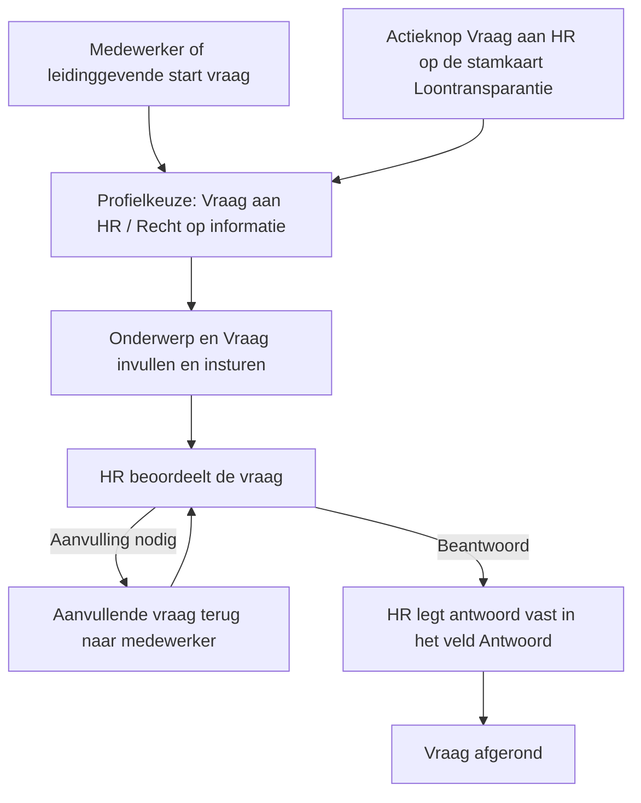

# FO DP4 – Vraag aan HR

> Functioneel ontwerp voor het nieuwe vaste type dossieritem **Vraag aan HR (Profit)**.
>
> Onderdeel van het [Programma Loontransparantie](../00_Programma_Loontransparantie.md). Scope en afbakening staan in [00_Scope.md](00_Scope.md). Laatste bijwerking: 2026-09-30.
>
> Structuur geïnspireerd op het [voorbeeldontwerp RHR01470 – Werkgeversverklaring](voorbeeldontwerp-RHR01470-werkgeversverklaring.md), maar bewust eenvoudiger opgezet.
>
> **Verwerkt op 16 september 2026: de uitkomsten van het overleg met PM van 15 september 2026.** Het veld Toelichting van het dossieritem gebruiken we niet meer, er komt een memoveld **Vraag** op de mutatietabel, er komt een eigen **type document** met een leeg document *Loontransparantie medewerker (Profit)*, de gereserveerde gegevensverzameling is vervangen door zes concrete verzamelingen, en Content levert **meerdere beoordeelprofielen** mee om instuurder en beoordelaar te scheiden.
>
> **Het voortgangsoverleg van 22 september 2026 herziet daarvan één onderdeel.** Het stuk dat in de workflow wordt gegenereerd wordt een **rapport** uit de workflow-editor en geen document; daarmee vervalt het **type document** "Vraag aan HR". Dat raakt §1.5, §2.1, §2.4, §3.4.1, §3.4.3, §3.4.4, §4.2.2, §4.3, §5.8, §7.3 en §8.4. Zie besluit 90, dat besluit 76 herziet.
>
> **Verwerkt op 29 september 2026: twee wijzigingen op DP4.** Het onderwerp wordt een eigen veld **Onderwerp** op de mutatietabel; het dossieritemveld **Omschrijving** staat op geen enkele pagina meer en wordt daaruit geprogrammeerd gevuld. Daarmee vervalt ook de standaard workflowoptie *Omschrijving aanpassen*. Daarnaast leveren we **geen workflow met een Jonas-onderdeel** meer mee. Dat raakt §1.1, §1.3, §1.5, §1.6, §1.7, §2.1, §2.3, §2.4, §3.1, §3.4.1, §3.4.3, §3.4.5, §4.2.2, §4.3.1, §4.3.2, §5.2, §5.7, §5.8, §5.9, §7.4, §8.2 en §8.3. Zie besluiten 111 en 112; besluit 112 herziet besluit 19 en laat besluit 15 vervallen.
>
> **Verwerkt op 30 september 2026: de twee gegevensverzamelingen met loontransparantiegegevens uit DP1 vervallen bij het type dossieritem.** Omdat we een **rapport** in de workflow genereren en geen document, legt het rapport zelf vast welke gegevens het toont. Het type dossieritem hoeft *Loontransparantie per inkomstenverhouding (actuele functie)* en *Loontransparantie per functiecategorie* dus niet meer beschikbaar te stellen; er blijven vier gegevensverzamelingen over. Dat raakt §1.5, §1.7, §2.1, §3.4.3, §3.4.4, §4.3.1 en §8.4.
>
> De vorige versies staan als momentopname in [_versies/20260914_01_FO_Vraag_aan_HR.md](_versies/20260914_01_FO_Vraag_aan_HR.md), [_versies/20260916_01_FO_Vraag_aan_HR.md](_versies/20260916_01_FO_Vraag_aan_HR.md) en [_versies/20260922_01_FO_Vraag_aan_HR.md](_versies/20260922_01_FO_Vraag_aan_HR.md).

---

## 1 Inleiding

### 1.1 Aanleiding

Bijna elke klant richt zelf een vrij dossieritem in waarmee medewerkers een vraag of aanvraag bij HR kunnen indienen. Uit onderzoek ON-06 blijkt dat dit massaal gebeurt: 1.218 actieve omgevingen, 278.873 ingestuurde items in twaalf maanden en in 78% van de omgevingen letterlijk het type "Aanvraag HR". Iedere klant bouwt hetzelfde patroon opnieuw op: een type dossieritem, een aanmaakprofiel, een beoordeelprofiel en een eenvoudige workflow.

Door dit als standaard uit te leveren in Profit hoeven klanten dit niet meer zelf te bouwen en te onderhouden. Tegelijk biedt het een vaste, aanvullende route naast de directe KPI-inzage uit DP1 (Recht op informatie): medewerkers die liever een vraag stellen met toelichting en opvolging, krijgen daarvoor een gestandaardiseerd proces.

Een bijkomend voordeel van de standaard uitlevering is dat het onderwerp, de vraag en het antwoord vaste velden worden met vaste namen. Bij vrije klantinrichting verschillen die per omgeving. Met een vast type dossieritem kan een klant er zelf een Jonas-opdracht op inrichten, omdat de velden overal hetzelfde heten (zie §3.4.5). AFAS levert die inrichting niet mee; de reden staat in §1.5.

### 1.2 Doel

Het proces "een vraag aan HR stellen" standaard uitleveren in Profit als een vast type dossieritem met standaardprofielen en een standaardworkflow, zodat klanten dit niet meer zelf hoeven in te richten.

### 1.3 Resultaat

Een standaard proces bestaande uit één vast type dossieritem, een aanmaakprofiel, meerdere beoordeelprofielen en één standaardworkflow, waarmee een medewerker via ESS, MSS, OutSite of Pocket een vraag aan HR indient. De medewerker legt het **Onderwerp** en de **Vraag** vast; HR beoordeelt die, kan om aanvulling vragen en legt het antwoord vast in het veld **Antwoord**. Naast het algemene profiel leveren we het profiel **Recht op informatie** mee, dat aansluit op de loontransparantie-richtlijn.

### 1.4 Vooronderzoek

Onderzoek ON-06 (Gebruikspatronen vrije dossiertypen) onderbouwt de standaardinrichting feitelijk:

- Het type wordt in de kern overal voor dezelfde functie gebruikt: een vrije vraag/aanvraag aan HR (71% van alle items, 1.158 omgevingen).
- Klanten onderscheiden soorten vragen via **profielen**, niet via de typenaam (gemiddeld 3,2 profielen per inrichting, uitschieters tot 43).
- De inrichting volgt consequent een **aanmaken → beoordelen**-patroon (22% van de profielen is een beoordeelstap).
- Vrijwel iedereen draait op één standaardworkflow "Aanvraag HR" (ID 1000069, circa 6.000 omgevingen), een eenvoudige aanvraag-en-beoordeel-flow.

Zie voor de volledige analyse [ON-06 · Analyse resultaten](../../01_Bronnen/Onderzoeken/ON-06_Gebruikspatronen_vrije_dossiertypen/ON-06_Analyse_resultaten_v0.1.md).

### 1.5 Afbakening

We kiezen voor een bewust eenvoudig proces. De medewerker stelt een vraag, HR beoordeelt en koppelt terug. Er zijn geen geprogrammeerde workflowacties nodig.

In scope:

- Eén vast type dossieritem "Vraag aan HR (Profit)" met een aanmaakprofiel en meerdere beoordeelprofielen.
- Eén standaardworkflow: vraag indienen → beoordeling door HR → terugkoppeling → afronden, met een terugloopstap voor aanvullende vragen.
- Twee standaardprofielen: **Vraag aan HR** (algemeen, default) en **Recht op informatie**, elk met een aanmaak- en een beoordeelvariant.
- Beschikbaarstelling via InSite (ESS en MSS), OutSite en Pocket.
- Een mutatietabel "Mutatie vraag aan HR" met een bijbehorende profieltabel "Profiel vraag aan HR", plus uitbreiding van de functiegroep "Profielen In- & Outsite" in de managementtool. De mutatietabel bevat naast de technische sleutelvelden drie functionele velden — **Onderwerp**, **Vraag** en **Antwoord** — en ondersteunt vrije velden, zodat de klant zelf informatie aan de vraag kan toevoegen (zie §4.2).
- Het geprogrammeerd vullen van het dossieritemveld **Omschrijving** met de waarde van het veld Onderwerp. De Omschrijving staat zelf op geen enkele pagina; de standaard workflowoptie "Omschrijving aanpassen" leveren we niet mee (zie §3.1).
- Het genereren van een **rapport** in de workflow. Het rapport legt zelf vast welke gegevens het toont; er komt géén type document.
- We leveren één rapport mee, **"Loontransparantie medewerker (Profit)"**; team Content maakt het op.

Buiten scope:

- Een apart profiel voor werkgeversverklaring: daarvoor bestaat al een eigen type dossieritem en profiel (RHR01470).
- **Jonas/AI-ondersteuning bij het beoordelen.** We leveren geen workflow met een Jonas-onderdeel mee. We kunnen de prompt daarin niet onderhouden: we kunnen hem eenmalig uitleveren, maar daarna kan de klant hem aanpassen. Onze voorkeur is een vaste prompt uit de promptbibliotheek, maar daarvoor is een aanpassing van team Algemeen nodig die niet meer in Profit 9 past. Een klant kan wel zelf een Jonas-opdracht inrichten op de velden Onderwerp, Vraag en Antwoord (zie §3.4.5). Volledig geautomatiseerd beantwoorden van vragen door Jonas/AI blijft nice-to-have in de backlog.
- De KPI-inzage zelf en de wettelijke rapportage over loonverschillen (zie DP1 en DP2).

### 1.6 Licentie en condities

De functionaliteit en bijbehorende inrichting worden generiek uitgeleverd onder de conditie **HR HRM/Payroll Base**. De vraag-aan-HR-route is niet landspecifiek.

Er komt geen aparte activering. Omdat we geen workflow met een Jonas-onderdeel meeleveren, is de bestaande activering **AFAS AI - Jonas** hier niet van toepassing (zie §1.5).

### 1.7 Randvoorwaarden

- Het profiel Recht op informatie leunt op de KPI-data uit DP1. Het rapport (§3.4.4) gebruikt daarvoor de gegevensverzamelingen die DP1 oplevert; de inhoud en het vulmoment daarvan zijn in DP1 uitgewerkt.
- De functionaliteit komt ook beschikbaar in de Pocket-app.
- De bestaande vrije klantinrichting blijft naast het nieuwe standaardtype bestaan; er is geen automatische conversie.

---

## 2 Globale beschrijving

We realiseren een workflowgestuurd proces waarmee een medewerker een vraag aan HR indient. Vanuit ESS, MSS, OutSite of Pocket start de medewerker (of de leidinggevende namens de medewerker) een aanvraag, met een onderwerp en zijn vraag. Via een workflow komt die bij HR, dat de vraag beoordeelt, eventueel om aanvulling vraagt en het antwoord terugkoppelt.

### 2.1 Twee profielen

De medewerker kiest bij het starten een profiel:

- **Vraag aan HR** (algemeen, default) — een vrije vraag aan HR. Dit dekt verreweg het grootste deel van het gebruik.
- **Recht op informatie** — een vraag in het kader van de loontransparantie-richtlijn. Bij dit profiel hoort het rapport met de loontransparantiegegevens uit DP1 (zie §3.4.4).

De medewerker kan dit profiel ook rechtstreeks starten vanaf de sectie Loontransparantie op de stamkaart, via de actieknop **Vraag aan HR** die in DP1 is ontworpen.

De profielen zijn uitbreidbaar. Klanten en team Content kunnen later extra profielen toevoegen zonder dat het type dossieritem hoeft te wijzigen. Dit sluit aan op de bevinding uit ON-06 dat differentiatie in de profielen zit, niet in de typenaam.

**Per profiel leveren we meerdere contexten mee**, zodat de instuurder en de beoordelaar van elkaar te onderscheiden zijn. De instuurder vult het **Onderwerp** en de **Vraag** en mag het **Antwoord** niet bewerken; de beoordelaar vult het Antwoord en mag het Onderwerp en de Vraag niet bewerken. De rechtenmatrix staat in §4.3.1.

### 2.2 Positionering naast KPI-inzage

Conform Besluit 02 is de directe KPI-inzage (DP1) de laagdrempelige basisroute. De vraag-aan-HR-flow is de **aanvullende route** voor medewerkers en organisaties die behoefte hebben aan een formele vraag met toelichting en opvolging. Beide routes bestaan naast elkaar; de medewerker kiest zelf.

### 2.3 Processflow

### 2.4 Inrichting op hoofdlijnen

- **Type dossieritem** — één nieuw vast type "Vraag aan HR (Profit)" met bestemming Medewerker, altijd afgehandeld via de workflow.
- **Profielen** — een aanmaakprofiel (Vraag aan HR), meerdere beoordeelprofielen, en het profiel Recht op informatie. Het type dossieritem ondersteunt ook "Starten in aanpassen", maar de standaardworkflow zet dit niet actief in (zie §3.4.1).
- **Workflow** — één standaardworkflow "Vraag aan HR (Profit)" met een terugloopstap voor aanvullende vragen. De definitieve inrichting is aan team Content.
- **Onderwerp** — de medewerker legt het onderwerp vast in het veld **Onderwerp** op de mutatietabel "Mutatie vraag aan HR" (zie §4.2.2). Het dossieritemveld **Omschrijving** wordt daaruit geprogrammeerd gevuld en staat zelf op geen enkele pagina (zie §3.1).
- **Vraag** — de medewerker legt zijn vraag vast in het memoveld **Vraag** op diezelfde mutatietabel. Het standaard dossieritemveld Toelichting gebruiken we niet.
- **Antwoord** — HR legt het antwoord vast in het memoveld **Antwoord** op diezelfde mutatietabel. Daardoor is het antwoord beschikbaar bij "Waarde toekennen" en bruikbaar in het rapport.
- **Rapport** — één rapport "Loontransparantie medewerker (Profit)", te selecteren in de workflow-editor (zie §3.4.4). Er komt geen type document.
- **Vrije velden** — het type ondersteunt vrije velden, zodat een klant zelf informatie aan de vraag kan toevoegen. Deze worden eveneens vastgelegd op de mutatietabel "Mutatie vraag aan HR" (zie §4.2.2).

---

## 3 Type dossieritem – Vraag aan HR

We voegen het nieuwe type dossieritem **Vraag aan HR (Profit)** toe.

### 3.1 Eigenschappen type dossieritem

**Dossier**

| Instelling | Waarde |
|---|---|
| Dossieritems nummeren | Ja |
| Begindatum | Ja |
| Einddatum | Nee |
| Aanleiding | Nee |
| Verantwoordelijke | Ja |

**Inhoud**

| Instelling | Waarde |
|---|---|
| Omschrijving | Ja — wordt geprogrammeerd gevuld met de waarde van het veld Onderwerp uit de mutatietabel (§4.2.2) en staat op geen enkele pagina |
| Toelichting | Nee — we gebruiken dit veld niet en tonen het niet |
| Bestand koppelen | Ja — meerdere bijlagen ondersteunen |

**De Omschrijving staat niet op het scherm.** Omschrijving is een veld van het dossieritem zelf, en daarop zijn geen veldinstellingen per profielcontext mogelijk. We tonen het daarom op geen enkele pagina en leggen het onderwerp vast in het veld **Onderwerp** op de mutatietabel (§4.2.2), waar veldinstellingen per context wél werken. Bij het insturen en bij elke wijziging schrijft de programmatuur de waarde van Onderwerp weg naar de Omschrijving.

**Onderwerp is verplicht vanuit programmatuur.** De Omschrijving is wat HR in de takenlijst ziet staan; blijft die leeg, dan is de taak niet te herkennen. Daarom kan de klant het veld Onderwerp niet onzichtbaar of optioneel maken. De overige veldinstellingen — label, volgorde en hulptekst — kan hij wel toepassen. Hierin wijkt Onderwerp af van Vraag en Antwoord (zie §4.3.1).

**De standaard workflowoptie "Omschrijving aanpassen" leveren we niet mee.** Die optie laat een behandelaar de Omschrijving los van de rest bewerken. Dat past niet bij dit type: de Omschrijving staat niet op het scherm en volgt automatisch het veld Onderwerp. Een wijziging langs die route zou bij de eerstvolgende mutatie weer worden overschreven. Wil een behandelaar het onderwerp wijzigen, dan doet hij dat op het veld Onderwerp.

**Het veld Toelichting gebruiken we niet.** Dat is een standaardveld van het dossieritem, en ook daarop zijn geen veldinstellingen mogelijk. We zouden het dus niet per profielcontext kunnen afschermen: de beoordelaar zou de toelichting van de instuurder kunnen overschrijven, en andersom. Daarom leggen we de vraag vast in het memoveld **Vraag** op de mutatietabel (§4.2.2), waar veldinstellingen per context wél werken. Het veld Toelichting tonen we op geen enkele pagina.

**Afhandeling**

| Instelling | Waarde |
|---|---|
| Afgehandeld | Ja |
| Datum afgehandeld | Ja |
| Bewerken | N (bewerken buiten workflow niet mogelijk) |

**Vertrouwelijk**

| Instelling | Waarde |
|---|---|
| Dossieritem altijd vertrouwelijk | Ja |

Vragen aan HR kunnen gevoelige informatie bevatten (bijvoorbeeld over salaris of een vertrouwenspersoon). Daarom is het type altijd vertrouwelijk: het dossieritem wordt uitgesloten van de reguliere dossieroverzichten en is alleen zichtbaar via de standaard weergave voor vertrouwelijke dossieritems, voor gebruikers die zowel op de medewerker als op de bestemming van het dossieritem zijn geautoriseerd. Zie hoofdstuk 6.

**Vrije velden**

| Instelling | Waarde |
|---|---|
| Vrije velden en tabbladen mogelijk maken | Ja |

De vrije velden worden vastgelegd op de mutatietabel "Mutatie vraag aan HR" (zie §4.2.2). Via de functiegroep "Profielen In- & Outsite" onderhoudt de klant de tabelvelden en maakt hij zelf vrije velden aan (zie §4.2.4).

**Jonas-opdrachten**

De vinkjes voor de Jonas-opdrachten staan **niet** standaard aan. Dit is een instelling op het type dossieritem en geldt dus voor de hele workflow, niet apart per stap in of uit te zetten:

| Instelling | Waarde |
|---|---|
| Zichtbaar voor instuurder van dossieritem | Nee (default) |
| Zichtbaar voor bestemming van dossieritem | Nee (default) |

Deze vinkjes zijn niet hetzelfde als de zichtbaarheidsvinkjes van het vertrouwelijke dossieritem zelf (zie §3.1 "Vertrouwelijk" en Besluit 11): het zijn twee losse instellingen die toevallig gelijk heten. Het Jonas-opdracht-part werkt namelijk los van deze vinkjes al automatisch: bij het aanmaken is het nooit zichtbaar, en bij het beoordelen is het standaard zichtbaar zodra de gebruiker ongelijk is aan de instuurder of de bestemming van het dossieritem — dus een HR-beoordelaar ziet het vanzelf. De vinkjes forceren zichtbaarheid van het Jonas-opdracht-part vóór de instuurder of de bestemming zelf, los van dat automatisme. Voor Vraag aan HR is dat niet nodig: het Jonas-opdracht-part is vooral een hulpmiddel voor HR, niet voor de medewerker die de vraag stelt.

### 3.2 Aanleiding

Het dossieritem krijgt geen mogelijkheid om een aanleiding in te vullen. Hierin wordt geen meerwaarde gezien.

### 3.3 Bestemmingen

Het dossieritem krijgt één bestemming:

- Medewerker (verplicht)

Bewust geen bestemming per dienstverband: een vraag aan HR is niet gebonden aan een specifiek dienstverband en de medewerker kan dit desgewenst zelf toelichten in de vraag. Een bestemming per dienstverband voegt complexiteit toe zonder duidelijke meerwaarde.

### 3.4 Workflow

#### 3.4.1 Standaard uitlevering

We leveren één standaardworkflow mee: **Vraag aan HR (Profit)**, voor beide profielen (Vraag aan HR algemeen en Recht op informatie).

De definitieve inrichting bepaalt team Content; beide profielen (algemeen en Recht op informatie) gaan naar HR.

Voor dit type dossieritem moet de workflow de mogelijkheid van **"Starten in aanpassen"** en **"Afwijkend profiel"** ondersteunen. "Starten in aanpassen" wordt in de standaardworkflow niet actief ingezet; het sjabloon blijft wel beschikbaar voor klanten die dit zelf willen gebruiken (zie §5.7). De standaard workflowoptie **"Omschrijving aanpassen"** leveren we niet mee (zie §3.1).

Het proces van de workflow:

1. De medewerker (of de leidinggevende namens de medewerker) start de workflow door een onderwerp en een vraag in te dienen. De programmatuur vult de Omschrijving van het dossieritem met de waarde van het veld Onderwerp (§3.1).
2. HR beoordeelt de vraag:
   - HR legt het antwoord vast in het memoveld **Antwoord** op de beoordeelpagina (§5.8). De velden **Onderwerp** en **Vraag** zijn daar zichtbaar maar niet wijzigbaar.
   - HR kan om aanvulling vragen; de vraag gaat dan via een reactie terug naar de medewerker en daarna weer naar HR.
3. HR rondt de beoordeling af. Als er een rapport is gegenereerd, wordt dat als bijlage aan het dossieritem toegevoegd.
4. De vraag wordt afgerond.

Het veld Antwoord is niet verplicht; team Content kan dit desgewenst in de workflowinrichting afdwingen. De reacties op het dossieritem blijven naast het veld Antwoord beschikbaar voor tussentijdse communicatie.

De workflow ondersteunt een terugloopstap voor aanvullende vragen. Er zijn geen geprogrammeerde workflowacties nodig.

#### 3.4.2 Workflowstatus

Er wordt **geen aparte workflowstatustabel** meegeleverd. De standaard dossierstatus (in behandeling / afgehandeld) volstaat voor dit eenvoudige proces. Eventuele routing wordt via profiel- en gegevensverzameling-condities geregeld.

#### 3.4.3 Gegevensverzamelingen voor condities

De volgende gegevensverzamelingen worden beschikbaar gemaakt bij dit dossieritem, zodat team Content de workflow conditioneel kan inrichten:

1. **Dossier**
2. **Dossier inclusief bestemming** — standaard gegevensverzameling met de dossieritemgegevens vanuit het perspectief van de bestemming (HR), nodig voor conditionering.
3. **Workflowmutatie vraag aan HR** — gebaseerd op de nieuwe tabel "Mutatie vraag aan HR" (§4.2.2), zodat de velden Onderwerp, Vraag en Antwoord en de vrije velden van de mutatie in condities beschikbaar zijn. Zie §4.3.2.
4. **Actuele gegevens medewerker**

**De twee gegevensverzamelingen met loontransparantiegegevens uit DP1 horen hier niet bij.** In de vorige versie stonden *Loontransparantie per inkomstenverhouding (actuele functie)* en *Loontransparantie per functiecategorie* nog in deze lijst, omdat een document zijn gegevens uit de verzamelingen van het type dossieritem haalt. Nu we een **rapport** genereren (§3.4.4), legt het rapport zelf vast welke gegevens het toont. Het type dossieritem hoeft die twee verzamelingen dus niet meer beschikbaar te stellen.

#### 3.4.4 Rapport en bijlage bij workflow

Het genereren van het stuk valt binnen de scope van DP4. Het wordt in de workflow gegenereerd door de HR-behandelaar bij het beoordelen; het resultaat wordt als bijlage bij het dossieritem opgeslagen.

**Het wordt een rapport en geen document.** Sinds Profit 9 kan de workflow-editor een rapport genereren. Omdat er in dit stuk niets hoeft te worden bewerkt — het wordt niet aangepast en niet ondertekend — is een rapport de betere keuze:

- Er is geen conversie van DOCX naar PDF nodig. Die stap is op AFAS Online merkbaar in de performance; de behandelaar en de medewerker wachten dus korter.
- Er is geen type document nodig om te bepalen welke gegevensverzamelingen beschikbaar zijn; dat legt het rapport zelf vast.

**Daarmee vervalt het type document "Vraag aan HR".** In de vorige versie van dit ontwerp maakten we een eigen type document aan, uitsluitend om te kunnen bepalen welke gegevensverzamelingen bij het opmaken beschikbaar zijn. Bij een rapport is dat niet nodig.

**Rapport "Loontransparantie medewerker (Profit)".** We leveren één rapport mee; team Content maakt het op. Het is bedoeld voor het profiel Recht op informatie: het toont het eigen loonniveau van de medewerker naast de gemiddelden van mannen en vrouwen in zijn functiecategorie, over alle arbeidsverhoudingen die hij heeft. Daarmee is het de uitgebreide route die de stamkaart in DP1 niet biedt, want die toont alleen het hoofddienstverband.

Voor de gegevens leunt het rapport op de twee verzamelingen die DP1 oplevert — *Loontransparantie per inkomstenverhouding (actuele functie)* en *Loontransparantie per functiecategorie* — inclusief velden, filters en vulmoment; zie de functionele beschrijving van DP1, §5.9. Het rapport legt die koppeling zelf vast; het type dossieritem hoeft ze niet beschikbaar te stellen (§3.4.3).

**Een vrije toelichting kan via een vrij veld.** Wil een klant tekst toevoegen die per geval verschilt, dan kan dat met een vrij memoveld op de mutatietabel (§4.2.2), dat vervolgens op het rapport wordt opgenomen. Dat vervangt de bewerkbaarheid die een document zou bieden.

**Let op: de rapportkeuze wordt nog niet gefilterd.** Er is geen relatie tussen de workflow waarin de behandelaar zit en het rapport dat hij kan selecteren, dus hij kiest uit de volledige lijst rapporten. Er is uitgezet of dat logischer kan. Zolang dat niet is opgelost, moet team Content de naamgeving zo kiezen dat het rapport in die lijst herkenbaar is.

Het rapport staat niet per profiel. Een klant die een eigen rapport wil voor het algemene profiel kan er zelf een toevoegen.

#### 3.4.5 Waarde toekennen

Op het type dossieritem moeten de (vrije) velden uit de volgende bestanden beschikbaar zijn bij **"Waarde toekennen"** in de workflow:

- **Dossier**
- **Mutatie vraag aan HR** (§4.2.2) — inclusief de velden **Onderwerp**, **Vraag** en **Antwoord**.

Dit moet worden uitgeprogrammeerd.

Hiermee kan een klant zelf een Jonas-opdracht in de workflow inrichten die het onderwerp of het antwoord voorvult. AFAS levert die inrichting en de bijbehorende prompt niet mee; de reden staat in §1.5. Schrijft zo'n opdracht een nieuwe waarde naar Onderwerp, dan volgt de Omschrijving van het dossieritem automatisch (§3.1).

---

## 4 Component – Profiel

### 4.1 Type profiel [Vraag aan HR]

We voegen een nieuw type profiel **Vraag aan HR** toe met contexten voor aanmaken en beoordelen.

#### 4.1.1 Nieuw wizard – Nieuw profiel

**Stap 1** — veldgroep Algemeen, type portal.

**Stap 2** — veldgroep Algemeen (alleen relevant voor soort "Aanmaken").

**Pagina's na voltooien wizard**

Aanmaken (type portal InSite of In & OutSite):

- Aanmaken vraag aan HR (ESS) [profielnaam]
- Aanmaken vraag aan HR (MSS) [profielnaam]
- Vraag aan HR profiel-medewerkerkeuze [profielnaam]

Aanmaken (type portal OutSite):

- Aanmaken vraag aan HR [profielnaam]

Beoordelen:

- Aanpassen vraag aan HR [profielnaam]
- Beoordelen vraag aan HR [profielnaam]

#### 4.1.2 Eigenschappen – Aanmaken

Tabblad Algemeen: veldgroep Algemeen, veldgroep Context.

#### 4.1.3 Eigenschappen – Beoordelen

Tabblad Algemeen: veldgroep Algemeen, veldgroep Context.

### 4.2 Datamodel

#### 4.2.1 Tabel Type profiel (AfasKnProfileType)

De tabel "Type profiel" uitbreiden met de waarde **Vraag aan HR**. Deze waarde verwijst naar de nieuwe profieltabel "Profiel vraag aan HR" (zie §4.2.3). Dit volgt het bestaande patroon van de werkgeversverklaring, waar het type profiel verwijst naar de tabel "Profiel werkgeversverklaring".

#### 4.2.2 Tabel [Mutatie vraag aan HR]

We leveren een **mutatietabel** "Mutatie vraag aan HR" mee bij het type dossieritem. Deze tabel is nodig om het onderwerp, de vraag en het antwoord vast te leggen en om **vrije velden** te kunnen ondersteunen, zodat een klant zelf informatie aan de vraag kan toevoegen.

De tabel bevat de **technische sleutelvelden** die nodig zijn om de mutatie aan het dossieritem en de medewerker te koppelen, plus drie functionele velden: **Onderwerp**, **Vraag** en **Antwoord**. De concrete indeling van de sleutelvelden volgt het bestaande patroon van de mutatietabel "Mutatie medewerker/werkgeversverklaring" en is verder aan de bouw.

| Veld | Type | Verplicht | Toelichting |
|---|---|---|---|
| Onderwerp | Tekst | Ja | Het onderwerp van de vraag. Wordt ingevuld op de aanmaakpagina (§5.2) en is bij aanpassen en beoordelen zichtbaar maar niet wijzigbaar. De waarde wordt geprogrammeerd weggeschreven naar de Omschrijving van het dossieritem (§3.1). Het veld krijgt daarom dezelfde lengte als die Omschrijving, zodat er niets wordt afgekapt |
| Vraag | Memo | Nee | De vraag van de medewerker. Wordt ingevuld op de aanmaakpagina (§5.2) en is bij het beoordelen zichtbaar maar niet wijzigbaar |
| Antwoord | Memo | Nee | Het antwoord van HR op de vraag. Wordt ingevuld op de beoordeelpagina (§5.8) |

**Waarom het onderwerp en de vraag op de mutatietabel staan en niet op het dossieritem zelf.** Op alle velden van de mutatietabel zijn veldinstellingen mogelijk via de context op het profiel. Op de Omschrijving en de Toelichting, beide velden van het dossieritem zelf, zijn die niet mogelijk (§3.1). Alleen met eigen velden kunnen we afdwingen dat de instuurder het onderwerp en de vraag vult en de beoordelaar ze niet overschrijft, en andersom voor het antwoord. Een eigen veld geeft de klant bovendien de ruimte om label, volgorde en hulptekst zelf te bepalen.

Hetzelfde geldt voor het antwoord. Dat leggen we bewust als **veld** vast en niet alleen als reactie op het dossieritem: alleen als veld is het beschikbaar bij "Waarde toekennen" (§3.4.5) en herbruikbaar in de gegevensverzameling (§4.3.2) en op het rapport (§3.4.4).

**De Omschrijving van het dossieritem volgt het veld Onderwerp.** Bij het insturen en bij elke wijziging schrijft de programmatuur de waarde van Onderwerp weg naar de Omschrijving (§3.1). De Omschrijving zelf staat op geen enkele pagina.

> **Documentatietip.** De velden van het dossieritem zijn standaard beschikbaar voor *waarde overnemen*. Wil een klant iets doen met de **Omschrijving** van het dossieritem, dan moet hij daarvoor het veld **Onderwerp** gebruiken. Vanuit Onderwerp wordt de Omschrijving automatisch bijgewerkt; andersom werkt dit niet.

De **reacties** op het dossieritem blijven daarnaast gewoon beschikbaar voor tussentijdse communicatie, bijvoorbeeld bij een aanvullende vraag; de velden Vraag en Antwoord vervangen die route niet.

#### 4.2.3 Tabel [Profiel vraag aan HR]

Bij het nieuwe type profiel hoort een eigen **profieltabel** "Profiel vraag aan HR". Hierin is een **context naar de mutatietabel** "Mutatie vraag aan HR" opgenomen, zodat de profielcontext (aanmaken en beoordelen) op de mutatietabel kan worden ingericht.

De opzet volgt het bestaande patroon van de tabel "Profiel werkgeversverklaring": een profielnummer, een verwijzing naar het beoordelingsprofiel en een contextveld dat naar de mutatietabel wijst.

#### 4.2.4 Functiegroep Profielen In- & Outsite

In de managementtool breiden we de functiegroep **Profielen In- & Outsite** uit met het bestand **Vraag aan HR**. Daarmee kan de klant de tabelvelden van de mutatietabel onderhouden en zelf vrije velden aanmaken. De mutatietabel "Mutatie medewerker/werkgeversverklaring" is op dezelfde manier onder deze functiegroep ondergebracht.

### 4.3 Output

#### 4.3.1 Standaard profielen

De volgende standaardprofielen worden meegeleverd:

- **Vraag aan HR** — standaard aanmaak- en beoordeelprofiel voor de algemene vraag (default).
- **Recht op informatie** — profiel dat aansluit op de loontransparantie-richtlijn, met het rapport met loontransparantiegegevens uit DP1 (zie §3.4.4).

**Content levert per profiel meerdere beoordeelprofielen mee**, zodat instuurder en beoordelaar van elkaar te onderscheiden zijn. Zonder dat onderscheid zouden beide rollen dezelfde veldinstellingen krijgen en zou een beoordelaar de vraag kunnen herschrijven of een instuurder het antwoord kunnen aanpassen.

De rechten per profielcontext:

| Veld | Aanmaken (instuurder) | Aanpassen (instuurder) | Beoordelen (beoordelaar) |
|---|---|---|---|
| Onderwerp | Zichtbaar, wijzigbaar, verplicht | Zichtbaar, niet wijzigbaar | Zichtbaar, niet wijzigbaar |
| Vraag | Zichtbaar, wijzigbaar | Zichtbaar, wijzigbaar | Zichtbaar, **niet** wijzigbaar |
| Antwoord | **Niet zichtbaar** | Zichtbaar, niet wijzigbaar | Zichtbaar, wijzigbaar |
| Vrije velden | Zichtbaar, wijzigbaar | Zichtbaar, wijzigbaar | Zichtbaar, wijzigbaar |

De instuurder mag de **Vraag** bij het aanpassen nog wijzigen, omdat dat precies de situatie is waarin HR om aanvulling heeft gevraagd. Het **Antwoord** is voor hem dan zichtbaar maar niet wijzigbaar, zodat hij kan lezen wat HR al heeft geschreven zonder het te kunnen overschrijven. Het **Onderwerp** ligt na het insturen vast, zodat de taak in de takenlijst van HR herkenbaar blijft.

**Onderwerp is de enige uitzondering op de vrije veldinstellingen.** Vraag, Antwoord en de vrije velden kan de klant desgewenst verbergen; Onderwerp niet. Dat veld is verplicht vanuit programmatuur, omdat de Omschrijving van het dossieritem eruit wordt gevuld (§3.1). De overige veldinstellingen op Onderwerp — label, volgorde en hulptekst — kan de klant wel toepassen.

Zodra de workflow is afgehandeld, is geen enkel veld meer wijzigbaar; dat is standaardgedrag en hoeft niet apart te worden ingericht.

Content bepaalt of er nog meer profielen of contexten nodig zijn.

#### 4.3.2 Gegevensverzameling [Workflowmutatie vraag aan HR]

We leveren een nieuwe gegevensverzameling **Workflowmutatie vraag aan HR** mee, gebaseerd op de tabel "Mutatie vraag aan HR" (§4.2.2). Deze wordt beschikbaar gesteld in de workflow en bij het rapport (§3.4.3), zodat team Content de workflow conditioneel kan inrichten en de velden Onderwerp, Vraag en Antwoord en de vrije velden van de mutatie op het rapport kan gebruiken.

#### 4.3.3 Gegevensverzameling [Mutatielogging (InSite en OutSite)]

De bestaande gegevensverzameling **Mutatielogging (InSite en OutSite)** breiden we uit met een alias naar de tabel "Mutatie vraag aan HR". Daarmee zijn ook de mutaties vanuit dit type dossieritem terug te vinden in de standaard mutatielogging van InSite en OutSite.

---

## 5 Inrichting InSite / OutSite

### 5.1 Type pagina – [Vraag aan HR]

We voegen een nieuwe type pagina **"Vraag aan HR"** toe. Deze wordt gebruikt voor het indienen, inzien, aanpassen en beoordelen van vragen aan HR.

### 5.2 Sjabloon – Aanmaken vraag aan HR (ESS)

Met dit sjabloon start de medewerker een vraag aan HR. De medewerker vult het onderwerp en zijn vraag in en kan een bijlage toevoegen. Op de pagina staan een toelichtende tekst (invulling door team Content) en de knoppen "Aanmaken" en "Annuleren".

Anders dan bij een technisch type dossieritem, waar het onderwerp meestal geprogrammeerd wordt gevuld, vult de medewerker bij "Vraag aan HR" zelf een vrij onderwerp in. Het veld **Onderwerp** uit de mutatietabel (§4.2.2) is hier dus **enabled en verplicht**. Er wordt geen vast onderwerp met bijvoorbeeld de medewerkernaam gevuld (dit wijkt af van de conventie in [ALG-I-2573](https://afas-software-b-v.aha.io/ideas/ideas/ALG-I-2573)). Redenen hiervoor:

- In de takenlijst van HR is de vraag direct herkenbaar aan het onderwerp.
- Filteren op onderwerp weegt zwaarder dan filteren op medewerkernaam.
- Een automatisch gevuld onderwerp mét medewerkernaam kan te lang worden en moet dan worden afgekapt; de gebruiker kan het onderwerp later niet meer wijzigen.
- "Vraag aan HR" is geen muterend proces zoals bijvoorbeeld een roosterwijziging of verlofaanvraag, maar leent zich voor een vrij invulbaar onderwerp.
- Klanten zijn dit al gewend van het bestaande vrije type dossieritem "Aanvraag HR".

**Veldvolgorde** — het veld **Onderwerp**, daaronder het memoveld **Vraag** — beide uit de mutatietabel "Mutatie vraag aan HR" (§4.2.2) — daaronder de bijlage en tot slot de veldgroep Extra gegevens.

De standaard dossieritemvelden **Omschrijving** en **Toelichting** tonen we niet (§3.1). De Omschrijving wordt geprogrammeerd gevuld met de waarde van het veld Onderwerp; voor de toelichting heeft de medewerker het veld Vraag.

**Veldgroep Extra gegevens** — hierin worden de vrije velden uit de mutatietabel "Mutatie vraag aan HR" getoond. De klant kan deze veldgroep zelf een naam geven. Als er geen vrije velden zijn, wordt de veldgroep verborgen.

Het veld **Antwoord** uit de mutatietabel is op deze pagina niet zichtbaar; het hoort bij het beoordelen (§5.8).

### 5.3 Sjabloon – Vraag aan HR profielkeuze (ESS)

Met dit sjabloon kiest de medewerker een profiel voor de vraag. Dit sjabloon gaat vooraf aan "Aanmaken vraag aan HR (ESS)".

### 5.4 Sjabloon – Aanmaken vraag aan HR (MSS)

Met dit sjabloon start de leidinggevende namens een medewerker een vraag aan HR. De MSS-pagina wordt hetzelfde opgemaakt als de ESS-pagina.

### 5.5 Sjabloon – Vraag aan HR profielkeuze (MSS)

Met dit sjabloon kiest de leidinggevende een profiel. Dit sjabloon gaat vooraf aan "Aanmaken vraag aan HR (MSS)".

### 5.6 Sjabloon – Vraag aan HR profiel-medewerkerkeuze

Wordt gebruikt voor de medewerkerselectie in de MSS-route. Dit sjabloon volgt op "Vraag aan HR profielkeuze (MSS)" en gaat vooraf aan "Aanmaken vraag aan HR (MSS)".

### 5.7 Sjabloon – Aanpassen vraag aan HR

Wordt gebruikt om vanuit de workflow direct een vraag aan te passen ("starten in aanpassen"). Het type dossieritem moet dit ondersteunen, maar de standaardworkflow zet dit niet actief in (zie §3.4.1). Dit sjabloon blijft beschikbaar, mocht een klant "Starten in aanpassen" alsnog willen inzetten.

- **Onderwerp** — zichtbaar, maar niet wijzigbaar. Het onderwerp ligt na het insturen vast, zodat de taak in de takenlijst van HR herkenbaar blijft.
- **Vraag** — zichtbaar en wijzigbaar, zodat de medewerker zijn vraag kan aanvullen wanneer HR daarom vraagt.
- **Antwoord** — zichtbaar, maar niet wijzigbaar. Zo kan de medewerker bij een aanvullende vraag het antwoord van HR niet overschrijven.
- **Veldgroep Extra gegevens** — vrije velden uit de mutatietabel "Mutatie vraag aan HR"; veldgroep verborgen als er geen vrije velden zijn.

### 5.8 Sjabloon – Beoordelen vraag aan HR

Wordt gebruikt voor ingestuurde vragen. De behandelaar bij HR kan de vraag beantwoorden, om aanvulling vragen en een rapport genereren en als bijlage toevoegen.

- **Onderwerp** — veld uit de mutatietabel, zichtbaar maar **niet wijzigbaar**.
- **Vraag** — memoveld uit de mutatietabel, zichtbaar maar **niet wijzigbaar**. De beoordelaar leest de vraag en herschrijft hem niet.
- **Antwoord** — memoveld uit de mutatietabel "Mutatie vraag aan HR" (§4.2.2), wijzigbaar en niet verplicht. Het veld staat onder Onderwerp en Vraag, boven de veldgroep Extra gegevens.
- **Veldgroep Extra gegevens** — vrije velden uit de mutatietabel "Mutatie vraag aan HR"; veldgroep verborgen als er geen vrije velden zijn.

Of Onderwerp, Vraag en Antwoord wijzigbaar zijn, volgt uit de **veldinstellingen per profielcontext**; de volledige matrix staat in §4.3.1. Zodra de workflow is afgehandeld, is geen enkel veld meer wijzigbaar; dat is standaardgedrag en hoeft niet apart te worden ingericht.

### 5.9 OutSite-sjablonen

Een aantal sjablonen wordt ook beschikbaar gemaakt in OutSite, zodat ook Payroll Cloud-werkgevers deze functionaliteit kunnen gebruiken:

- Aanmaken vraag aan HR
- Vraag aan HR medewerker profielkeuze
- Aanpassen vraag aan HR
- Beoordelen vraag aan HR

Voor de velden Onderwerp, Vraag en Antwoord gelden in OutSite dezelfde veldinstellingen per profielcontext als in InSite (§4.3.1, §5.2, §5.7 en §5.8).

### 5.10 Functionaliteit ESS/Vraag aan HR

De functionaliteit "ESS/Vraag aan HR" wordt gebruikt voor het insturen, aanpassen en inzien van de vraag vanuit de medewerker (InSite).

### 5.11 Functionaliteit MSS/Vraag aan HR (InSite)

De functionaliteit "MSS/Vraag aan HR" wordt gebruikt voor het insturen namens een medewerker en het beoordelen van de vraag vanuit de leidinggevende/HR (InSite).

### 5.12 Functionaliteit MSS/Vraag aan HR (OutSite)

De functionaliteit "MSS/Vraag aan HR" wordt gebruikt voor het insturen, aanpassen en beoordelen van de vraag (OutSite).

### 5.13 Plek op de standaard stamkaart en het ESS-overzicht

Op de overzichtspagina van de standaard ESS- en MSS-stamkaart wordt een actie **"Vraag aan HR"** toegevoegd, onderaan de bestaande acties, direct onder de actie "Uitdienst". Vanuit deze actie start de medewerker (ESS) of de leidinggevende namens de medewerker (MSS) de workflow.

We voegen bewust geen actie toe op het tabblad Dossier: daar staan momenteel nog geen acties en dit zou de deur openzetten voor talloze vergelijkbare acties op dat tabblad.

**Daarnaast komt er een tweede ingang**, ontworpen in DP1: een actieknop **Vraag aan HR** in de sectie Loontransparantie op de stamkaart, die rechtstreeks het profiel *Recht op informatie* opstart. De medewerker hoeft dan geen profiel meer te kiezen. Beide ingangen leiden tot hetzelfde type dossieritem en dezelfde workflow.

---

## 6 Component – Dossier

Een vraag aan HR kan vertrouwelijke informatie bevatten. Daarom is het type dossieritem "Vraag aan HR" altijd vertrouwelijk: het dossieritem wordt uitgesloten van de reguliere dossieroverzichten en is alleen zichtbaar via de standaard weergave voor vertrouwelijke dossieritems. Een gebruiker ziet het dossieritem alleen als hij zowel op de medewerker als op de bestemming van het dossieritem (HR) is geautoriseerd.

---

## 7 Pocket

### 7.1 Plek in het menu

De vraag aan HR wordt, net als de werkgeversverklaring, beschikbaar gemaakt onder het eigen menu-item **"HR-mutaties"** in Pocket, niet onder "Mijn dossier". Hiervoor is **POA-462571** ingediend bij het Pocket-team: het nieuwe type dossieritem moet als Pocket-subject worden geregistreerd voordat het beschikbaar kan worden gesteld. Na oplevering van de POA richt de klant het menu-item zelf in via Pocket-instellingen > Vrije inrichting > Mijn Pocket menu, met menu-itemtype "HR-mutatie", gekoppeld aan het aanmaakprofiel.

### 7.2 Vraag indienen

De medewerker kan een vraag aan HR indienen via AFAS Pocket, via de functionaliteit onder "HR-mutaties". Voor Payroll Cloud Pocket-gebruikers loopt dit via de OutSite-sjablonen.

### 7.3 Vraag beoordelen

Workflowtaken kunnen via Pocket worden afgehandeld. Het dossieritem "Vraag aan HR" verschijnt dan onder het menu-item "Mijn taken". De behandelaar kan de vraag lezen en het veld Antwoord invullen; het genereren van het rapport blijft een backoffice-taak.

### 7.4 Velden en opmaak

De aanmaken- en beoordelen-pagina's in Pocket volgen dezelfde velden en opzet als de InSite-sjablonen: het veld Onderwerp, het veld Vraag, bijlage(n), het veld Antwoord en eventuele vrije velden (zie §5.2 en §5.8). Ook in Pocket gelden dezelfde veldinstellingen per profielcontext (§4.3.1). Dit valt binnen de scope van dit FO; de Pocket-POA (zie §7.1) werkt dit verder technisch uit voor plaatsing onder het Pocket-menu "HR-mutaties".

---

## 8 Content

### 8.1 Template en demo-omgevingen

In de template en demo-omgevingen wordt de bestaande vrije "Aanvraag HR"-inrichting verwijderd ten gunste van het nieuwe standaardtype "Vraag aan HR (Profit)". De bestaande vrije inrichting bij klanten blijft ongemoeid; er is geen automatische conversie.

### 8.2 Profielen

Team Content levert de standaardprofielen met contexten mee: **Vraag aan HR** (algemeen) en **Recht op informatie**. Per profiel komen er **meerdere beoordeelprofielen**, zodat instuurder en beoordelaar van elkaar te onderscheiden zijn en de veldinstellingen uit de rechtenmatrix in §4.3.1 kunnen worden ingericht — voor **Onderwerp**, **Vraag**, **Antwoord** en de vrije velden. Let op de uitzondering: Onderwerp is verplicht vanuit programmatuur en kan niet worden verborgen (§3.1). Zie hoofdstuk 4. Content bepaalt of er nog extra profielen nodig zijn.

### 8.3 Workflows

Team Content richt de standaardworkflow "Vraag aan HR (Profit)" definitief in, met een beoordeelstap door HR en een terugloopstap voor aanvullende vragen. Zowel het algemene profiel als Recht op informatie gaan naar HR. De standaard workflowoptie "Omschrijving aanpassen" wordt niet meegeleverd (§3.1), en er komt geen Jonas-onderdeel in de workflow (§1.5).

### 8.4 Rapport

We leveren één rapport mee: **"Loontransparantie medewerker (Profit)"** (§3.4.4). Team Content maakt dat op. Er komt **geen type document**; het rapport wordt rechtstreeks in de workflow-editor geselecteerd.

Voor het opmaken bepaalt het rapport zelf welke gegevens het toont; daarvoor gebruikt Content de twee verzamelingen met loontransparantiegegevens uit DP1. Het veld Antwoord komt uit de gegevensverzameling "Workflowmutatie vraag aan HR" (§4.3.2).

Let daarbij op de naamgeving: de rapportkeuze in de workflow wordt nog niet gefilterd op de workflow waarin de behandelaar zit, dus het rapport moet herkenbaar zijn in de volledige lijst (§3.4.4).

### 8.5 Autorisatierollen

De beoordeling van welke standaard autorisatierollen worden meegeleverd, wordt aan team Content overgelaten. In elk geval is toegang nodig voor de medewerker (indienen/inzien eigen vraag), de leidinggevende (indienen namens/beoordelen) en de HR-behandelaar (beoordelen/afhandelen), inclusief de OutSite-varianten.
