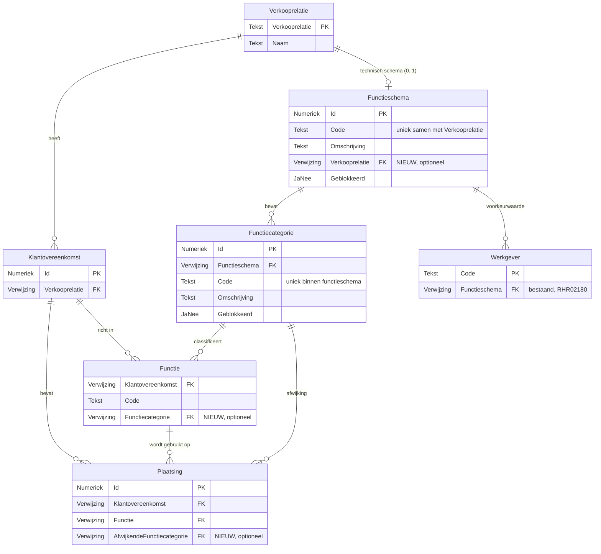

# Ontwerp: Functiecategorie en flex

| | |
|---|---|
| **Project** | RHR02082 – deelproject 5 |
| **Versie** | 0017 |
| **Datum** | 07-10-2026 |
| **Status** | Concept |
| **Module** | HRM / Flex |
| **Gepland voor** | Nader te bepalen (na Profit 8) |
| **Auteur** | Guus Schoonderbeek |
| **Bouwt voort op** | RHR02180 – Functiecategorie op functie |

---

## Versiehistorie

| Versie | Datum | Auteur | Wijziging |
|---|---|---|---|
| 0001 | 25-09-2026 | Guus Schoonderbeek | Eerste uitwerking. Keuze voor een technisch functieschema per verkooprelatie (optie A), uitbreiding van de bestaande import met een kolom Verkooprelatie |
| 0002 | 25-09-2026 | Guus Schoonderbeek | Review verwerkt: functiegroepen-model toegevoegd (§1.2), user story autorisatie toegevoegd (US17), meldingstekst voor een geblokkeerde functiecategorie toegevoegd (M24), integriteitsregels opgeschoond |
| 0003 | 25-09-2026 | Guus Schoonderbeek | Bevestigd dat de klantovereenkomst van een bestaande plaatsing niet wijzigbaar is. IR16 en melding M21 vervallen daarmee |
| 0004 | 25-09-2026 | Guus Schoonderbeek | Mockups en Podium-specificaties toegevoegd voor US10, US11 en US12 |
| 0005 | 25-09-2026 | Guus Schoonderbeek | Begrip 'effectieve functiecategorie' vervallen. De gegevensverzameling Plaatsingen krijgt alleen het functieveld Functiecategorie; Afwijkende functiecategorie is daar automatisch beschikbaar |
| 0006 | 25-09-2026 | Guus Schoonderbeek | Mutatietabellen expliciet benoemd in §3.4 (profieltabellen wijzigen niet). Aanmaken van een functie binnen een klantovereenkomst vanuit InSite toegevoegd aan US15 |
| 0007 | 25-09-2026 | Guus Schoonderbeek | US17: vastgelegd dat het nieuwe autorisatieproces standaard niet is toegekend, waardoor de conversie een voorwaarde is in plaats van een afronding |
| 0008 | 25-09-2026 | Guus Schoonderbeek | US17 gecorrigeerd: een beheerder kan het proces altijd zelf toekennen via de autorisatietool. De conversie voorkomt handwerk, maar is geen voorwaarde |
| 0009 | 25-09-2026 | Guus Schoonderbeek | Veldinfo expliciet buiten scope geplaatst, in lijn met RHR02180 |
| 0010 | 25-09-2026 | Guus Schoonderbeek | Weergavenummering vastgelegd (`FuC02` is vrij) en de volgorde-afhankelijkheid tussen weergave en tabblad benoemd |
| 0011 | 25-09-2026 | Guus Schoonderbeek | De standaardweergave Plaatsingen wordt niet uitgebreid. De velden blijven wel beschikbaar in de gegevensverzameling |
| 0012 | 25-09-2026 | Guus Schoonderbeek | Open punten OP01 t/m OP06 afgehandeld: conversie in scope, historie belegd bij DP2, tabbladpositie bevestigd, geen plaatsingen op het tabblad Functies, prestatie akkoord. Alleen OP07 blijft open |
| 0013 | 25-09-2026 | Guus Schoonderbeek | OP08 toegevoegd voor het uitvraagformulier gelijkwaardige beloning. De uitvraag inlenersbeloning kent nu geen functieregels; PM bepaalt of een functiecategorie daar nodig is |
| 0014 | 25-09-2026 | Guus Schoonderbeek | Mockups en Podium-specificaties verwijderd omdat ze een verkeerd beeld geven. De functionele beschrijving onder 'Scherm en gedrag' is leidend. Tabbladpositie functioneel vastgelegd bij US10 |
| 0015 | 25-09-2026 | Guus Schoonderbeek | Het veld Verkooprelatie krijgt de conditie Flex op de velddefinitie (IR18), zodat die overal doorwerkt: schermen, weergaven, gegevensverzamelingen, imports en InSite |
| 0016 | 06-10-2026 | Guus Schoonderbeek | Triggerafspraak met DP1 vastgelegd in §3.3, §3.4 en §4.2: een wijziging van de functiecategorie op de functie van de klantovereenkomst of van de afwijkende functiecategorie op de plaatsing laat DP1 de loontransparantiegegevens over het hele venster opnieuw opbouwen (DP1, blok AI). OP07 is daarmee aan DP1-zijde gesloten en blijft alleen voor DP2 open |
| 0017 | 07-10-2026 | Guus Schoonderbeek | US18 toegevoegd: gegevensverzameling **Functies per functiecategorie (klantovereenkomst)**, nodig om in het rapport van DP1 de functies van een functiecategorie te tonen. Een zuivere verzameling op de functies van de klantovereenkomst met hun functiecategorie; de afwijkende functiecategorie op de plaatsing staat er bewust niet in, want die zegt iets over de pláátsing en niet over de functie. §3.5 heet nu Gegevensverzamelingen en beschrijft beide |

---

## 1. Inleiding

### 1.1 Aanleiding

In RHR02180 is voor Profit 8 de basis gelegd voor **functieschema's** en **functiecategorieën**. Een functieschema bundelt een set functiecategorieën onder één functionele sleutel; bij elke werkgever leg je vast welk functieschema geldt. Op de werkgeverfunctie kies je vervolgens een functiecategorie uit dat schema.

Dat model past goed bij reguliere werkgevers, maar niet bij uitzendorganisaties. RHR02180 benoemde dit al expliciet als vierde klantgroep:

> Omgeving van een uitzendorganisatie. Klantspecifieke functiecategorieën horen bij een verkooprelatie. In een latere Profit-versie willen we het functieschema ook aan een verkooprelatie kunnen koppelen (onder activering Flex). Deze uitbreiding valt buiten scope van dit project, maar de opzet maakt het mogelijk.

Dit deelproject werkt die uitbreiding uit. Bij een uitzendorganisatie hoort de indeling in functiecategorieën namelijk niet bij de eigen werkgever, maar bij de **inlener**. Iedere inlener heeft een eigen functiehuis en dus een eigen set categorieën. In Profit is de inlener vastgelegd als **verkooprelatie**.

De vastlegging loopt daarna door via de keten die uitzenders al gebruiken:

- Onder een verkooprelatie liggen één of meer **klantovereenkomsten**.
- Binnen een klantovereenkomst worden **functies** ingericht.
- Een **plaatsing** verwijst naar zo'n functie.

Het koppelen van een functiecategorie is nadrukkelijk **optioneel**. Niet alle uitzendklanten werken met functies, en kleine inleners passen vaak helemaal geen functiecategorieën toe. Op de plaatsing moet bovendien van de standaard kunnen worden afgeweken.

#### Waarom geen functieschema op de verkooprelatie

De voor de hand liggende route is om het bestaande model één-op-één door te trekken: koppel een functieschema aan de verkooprelatie, net zoals dat nu bij de werkgever gebeurt. Binnen Flex is dat echter als omslachtig beoordeeld. Een uitzender met duizenden inleners zou dan voor iedere inlener eerst een functieschema moeten aanmaken en onderhouden in een apart HRM-scherm, voordat er één categorie kan worden vastgelegd.

Het uitgangspunt van dit ontwerp is daarom: **functiecategorieën worden onderhouden vanuit de eigenschappen van de verkooprelatie, maar technisch opgeslagen in dezelfde tabel als de HRM-functiecategorieën.** De gebruiker ziet nooit een functieschema. Hoofdstuk 4 onderbouwt deze keuze.

### 1.2 Het functiegroepen-model

De wet vergelijkt lonen binnen een groep medewerkers die gelijkwaardig werk doet. De vraag is welke eenheid in Profit die groep vormt.

Het antwoord ligt al vast in DP1: **de functiecategorie is die eenheid**. Het begrippenkader daar omschrijft de vergelijkingsgroep als alle arbeidsverhoudingen in dezelfde functiecategorie, uitgesplitst naar geslacht. Er zit dus geen extra groeperingslaag tussen functie en vergelijkingsgroep: een functie hoort bij één categorie, en die categorie is de groep waarover wordt vergeleken. Waar DP2 spreekt over een functiegroep, gaat het om dezelfde eenheid.

Wat per populatie verschilt, is binnen welke grens die categorie geldt:

| Populatie | Vergelijkingsgroep | Waar de categorie is vastgelegd |
|---|---|---|
| Eigen medewerkers | Functiecategorie binnen het RSIN van de werkgever | Op de werkgeverfunctie, via het functieschema van de werkgever (RHR02180) |
| Uitzendkrachten | Functiecategorie binnen één verkooprelatie | Op de functie van de klantovereenkomst, of als afwijking op de plaatsing (dit ontwerp) |

Bij eigen medewerkers bepaalt de werkgever de indeling en deelt hij die met andere werkgevers onder hetzelfde RSIN. Bij uitzendkrachten bepaalt de **inlener** de indeling, en geldt die alleen bij die ene inlener. Een uitzendkracht wordt daarom nooit vergeleken met uitzendkrachten bij een andere inlener, ook niet als de categoriecode daar toevallig gelijk is.

Dat heeft een gevolg voor de rapportage. Bij eigen medewerkers verdicht de rapportage op de **code** van de functiecategorie, zodat werkgevers onder hetzelfde RSIN op één noemer komen. Bij uitzendkrachten kan dat niet, want codes mogen herhalen tussen inleners. Hoofdstuk 4 werkt dit uit.

### 1.3 Resultaat

Dit deelproject levert de volgende functionaliteit:

1. **Tabblad Functiecategorie op de verkooprelatie** — met een weergave van de functiecategorieën van die verkooprelatie en de acties Nieuw, Eigenschappen en Verwijderen.
2. **Technisch functieschema per verkooprelatie** — automatisch aangemaakt en opgeruimd, nooit zichtbaar voor de gebruiker.
3. **Functiecategorie op de functie van een klantovereenkomst** — een optioneel veld, gefilterd op de verkooprelatie van de klantovereenkomst.
4. **Functiecategorie en afwijkende functiecategorie op de plaatsing** — een niet-wijzigbaar veld dat de categorie van de functie toont, plus een optioneel veld om daarvan af te wijken.
5. **Uitbreiding import functiecategorie** — de bestaande import krijgt een kolom Verkooprelatie.
6. **Uitbreiding import functies klantovereenkomst** — veld Functiecategorie toevoegen.
7. **Uitbreiding imports plaatsing** — veld Afwijkende functiecategorie toevoegen.
8. **Velden in InSite** — op de functie van de klantovereenkomst en op de plaatsing.
9. **Afscherming in HRM** — functieschema's die bij een verkooprelatie horen zijn niet zichtbaar in de HRM-weergaven en -zoekverwijzingen.
10. **Gegevensverzameling Functies per functiecategorie (klantovereenkomst)** — per functie van een klantovereenkomst de functiecategorie waarin die is ingedeeld, over alle klantovereenkomsten van de verkooprelatie heen.

### 1.4 Afbakening

| In scope | Toelichting |
|---|---|
| Functiegroepen-model | Vaststellen dat de functiecategorie de wettelijke vergelijkingseenheid is, en wat dat betekent voor uitzendkrachten |
| Functiecategorie per verkooprelatie | Onderhoud vanaf het eigenschappenscherm van de verkooprelatie |
| Technisch functieschema | Automatisch aanmaken en opruimen, niet zichtbaar en niet onderhoudbaar voor de gebruiker |
| Uniciteit per verkooprelatie | De code van een functiecategorie is uniek binnen één verkooprelatie en mag herhalen tussen verkooprelaties |
| Functiecategorie op functie klantovereenkomst | Optioneel veld, gefilterd op de verkooprelatie |
| Functiecategorie op plaatsing | Niet-wijzigbaar veld, afgeleid van de functie |
| Afwijkende functiecategorie op plaatsing | Optioneel veld, gefilterd op de verkooprelatie |
| Uitbreiding bestaande imports | Functiecategorie, functies klantovereenkomst en plaatsing |
| InSite-velden | Functie klantovereenkomst en plaatsing |
| Afscherming in HRM | Flex-functieschema's uitfilteren in weergaven, gegevensverzamelingen en zoekverwijzingen |
| Autorisatie | Nieuw autorisatieproces voor het tabblad Functiecategorie op de verkooprelatie |
| Gegevensverzameling Functies per functiecategorie | Nieuwe verzameling met per functie van een klantovereenkomst de ingedeelde functiecategorie, over alle klantovereenkomsten van de verkooprelatie. Nodig voor het rapport in DP1 |
| Conversie | De conversie van de unieke sleutel van Functieschema en de autorisatieconversie worden binnen dit project opgeleverd |

| Buiten scope | Toelichting |
|---|---|
| Onderhoud functiecategorieën in InSite | Er zal een klantwens ontstaan om functiecategorieën ook via InSite te onderhouden. Vanwege de doorlooptijd realiseren we dit nu niet |
| GetConnectors | Net als in RHR02180 worden er geen GetConnectors meegeleverd. De gegevens zijn beschikbaar via de standaard gegevensverzamelingen |
| Veldinfo | Er wordt geen veldinfo bij de nieuwe velden meegeleverd. Ook RHR02180 heeft dat niet gedaan voor functieschema en functiecategorie. Content bepaalt zelf of en wanneer dit alsnog gebeurt |
| Tijdsafhankelijke vastlegging | De koppelingen zijn niet tijdsafhankelijk, in lijn met RHR02180 |
| Uitvraagformulier gelijkwaardige beloning | Maakt deel uit van deelproject 5, maar wordt apart uitgewerkt. Zie `00_Scope.md` en OP08 |
| Wettelijke rapportage | Zie DP2 – Rapportage |
| Wijzigingen aan werkgever en werkgeverfunctie | De functionaliteit uit RHR02180 blijft ongewijzigd |

### 1.5 Randvoorwaarden

| Randvoorwaarde | Toelichting |
|---|---|
| RHR02180 is uitgeleverd | Dit ontwerp bouwt voort op de tabellen Functieschema en Functiecategorie uit Profit 8 |
| Latere build dan RHR02180 | Er staat al klantdata in de tabellen. De wijziging aan de unieke sleutel van Functieschema vraagt daarom een conversiescript |
| Activering Flex | De nieuwe functionaliteit is alleen zichtbaar bij een actieve Flex-activering |
| Geen invloed op salarisverwerking | De functiecategorie heeft geen invloed op de verwerking van plaatsingen, declaraties of facturatie |
| Tijdkritisch | De vastlegging moet staan voordat de gegevens over 2027 worden opgebouwd. Zie `00_Scope.md` |

### 1.6 Begrippen

| Begrip | Omschrijving |
|---|---|
| Verkooprelatie | De inlener: de klant van de uitzendorganisatie waaraan uitzendkrachten ter beschikking worden gesteld |
| Klantovereenkomst | De overeenkomst met een verkooprelatie waaronder plaatsingen en prijsafspraken vallen |
| Functie (klantovereenkomst) | Een functie die binnen een klantovereenkomst is ingericht en waarnaar een plaatsing verwijst |
| Plaatsing | De terbeschikkingstelling van een uitzendkracht aan een verkooprelatie, onder een klantovereenkomst en een functie |
| Functiecategorie | Groep functies die als gelijkwaardig worden beschouwd in het kader van loontransparantie |
| Functiegroep | Synoniem voor functiecategorie. DP2 gebruikt deze term voor dezelfde eenheid |
| Vergelijkingsgroep | De arbeidsverhoudingen waarmee het loon van een medewerker wordt vergeleken: alle arbeidsverhoudingen in dezelfde functiecategorie, uitgesplitst naar geslacht |
| Functieschema | Set functiecategorieën met een eigen functionele sleutel. Bij Flex een technisch hulpmiddel dat niet zichtbaar is |
| Technisch functieschema | Een functieschema dat automatisch bij een verkooprelatie hoort en niet door een gebruiker wordt onderhouden |

### § Bijlagen

| Bijlage | Onderwerp |
|---|---|
| [Bijlage A – Samenvatting voor klant](#bijlage-a--samenvatting-voor-klant) | Niet-technische samenvatting |
| [Bijlage B – Testscenario's](#bijlage-b--testscenarios) | Testscenario's per user story |
| [Bijlage C – Open punten](#bijlage-c--open-punten) | Openstaande beslissingen |
| [Bijlage D – Technische verankering](#bijlage-d--technische-verankering) | Vindplaatsen in de Profit-repository |

---

## 2. User stories

### 2.1 Overzicht

| Nr | User story | Toelichting |
|---|---|---|
| US10 | Functiecategorieën onderhouden op de verkooprelatie | Nieuw tabblad met weergave en onderhoud |
| US11 | Functiecategorie koppelen aan de functie van een klantovereenkomst | Optioneel veld, gefilterd op de verkooprelatie |
| US12 | Functiecategorie en afwijkende functiecategorie op de plaatsing | Afgeleid veld plus optionele afwijking |
| US13 | Uitbreiding import functiecategorie | Kolom Verkooprelatie toevoegen aan de bestaande import |
| US14 | Uitbreiding imports functie en plaatsing | Functiecategorie en afwijkende functiecategorie meenemen |
| US15 | Velden beschikbaar in InSite | Functie klantovereenkomst en plaatsing |
| US16 | Flex-functieschema's afschermen in HRM | Geen zichtbaarheid in HRM-weergaven en -zoekverwijzingen |
| US17 | Autorisatie op de functiecategorieën van een verkooprelatie | Eigen autorisatieproces voor het nieuwe tabblad |
| US18 | Gegevensverzameling Functies per functiecategorie (klantovereenkomst) | Welke functies bij een functiecategorie zijn ingedeeld, over alle klantovereenkomsten van de verkooprelatie |

---

### 2.2 US10 – Functiecategorieën onderhouden op de verkooprelatie

Als **flexbeheerder** wil ik per verkooprelatie functiecategorieën kunnen vastleggen en onderhouden, zodat ik het functiehuis van die inlener kan indelen zonder eerst een functieschema te hoeven aanmaken.

#### Functionele uitwerking

- Het onderhoud vindt plaats op het eigenschappenscherm van de verkooprelatie, op een nieuw tabblad Functiecategorie.
- De gebruiker ziet en kiest nooit een functieschema. Achter de schermen hoort elke verkooprelatie bij een eigen technisch functieschema, dat automatisch wordt aangemaakt zodra de eerste functiecategorie wordt vastgelegd.
- De code van een functiecategorie is uniek binnen de verkooprelatie. Twee verkooprelaties mogen dezelfde code gebruiken.
- Geblokkeerde functiecategorieën zijn niet selecteerbaar bij een functie of plaatsing, maar blijven zichtbaar waar ze al gekoppeld zijn.
- Blokkeer je de verkooprelatie zelf, dan blijven de functiecategorieën ongewijzigd bestaan. Ze zijn nog steeds zichtbaar op bestaande functies en plaatsingen, maar er komen geen nieuwe klantovereenkomsten of plaatsingen meer bij waarop je ze kunt kiezen.
- Het tabblad is alleen zichtbaar bij een actieve Flex-activering.
- Conversie van bestaande gegevens is niet nodig: er zijn nog geen functiecategorieën op verkooprelatieniveau.

#### Scherm en gedrag

##### Eigenschappenscherm: Verkooprelatie (wijziging)

| Onderdeel | Waarde |
|---|---|
| Tabblad | Functiecategorie (nieuw) |
| Positie | Tussen de tabbladen Kostenplaats en Inlenersbeloning |
| Zichtbaarheid | Alleen bij actieve Flex-activering |
| Autorisatie | Nieuw autorisatieproces voor het tabblad |

##### Weergave: Functiecategorie (binnen verkooprelatie)

| Onderdeel | Waarde |
|---|---|
| Gegevensverzameling | Functiecategorie per verkooprelatie |
| Filter | Verkooprelatie = huidige verkooprelatie |
| Standaardsortering | Code (oplopend) |

**Kolommen:**

| Kolom | Toelichting |
|---|---|
| Code | Code van de functiecategorie, uniek binnen de verkooprelatie |
| Omschrijving | Omschrijving |
| Toelichting | Toelichting |
| Geblokkeerd | Ja/nee |

**Acties:**

| Actie | Beschrijving | Primair | Autorisatie | Regelgebonden |
|---|---|---|---|---|
| Nieuw | Opent de wizard Nieuwe functiecategorie binnen deze verkooprelatie | Ja | Autoriseerbaar | Nee |
| Eigenschappen | Opent het eigenschappenscherm van de functiecategorie | Ja | Autoriseerbaar | Ja |
| Verwijderen | Verwijdert de geselecteerde functiecategorie(ën) | Ja | Autoriseerbaar | Ja, meerdere of enkele regels |

**Uitzonderingen bij verwijderen**, in deze volgorde gecontroleerd:

1. Is de functiecategorie gekoppeld aan een functie van een klantovereenkomst, dan wordt de verwijdering geblokkeerd met melding M15.
2. Is de functiecategorie vastgelegd als afwijkende functiecategorie op een plaatsing, dan wordt de verwijdering geblokkeerd met melding M16.

##### Wizard: Nieuwe functiecategorie (verkooprelatie)

| Onderdeel | Waarde |
|---|---|
| Type | Nieuw |
| Titel | Nieuwe functiecategorie |
| Context | Wordt geopend vanuit een verkooprelatie. De verkooprelatie is voorgevuld en niet wijzigbaar. Het functieschema wordt niet getoond |

**Stap 1 – Algemeen:**

| Veldgroep | Veld | Type | Verplicht | Toelichting |
|---|---|---|---|---|
| Algemeen | Verkooprelatie | Tabelkoppeling | Ja | Voorgevuld vanuit context, niet wijzigbaar. Conditie Flex (IR18) |
| Algemeen | Code | Tekst | Ja | Unieke code binnen de verkooprelatie, maximaal 10 posities |
| Algemeen | Omschrijving | Tekst | Ja | Maximaal 50 posities |
| Algemeen | Toelichting | Memo | Nee | Vrije toelichting |

##### Eigenschappenscherm: Functiecategorie (verkooprelatie)

| Onderdeel | Waarde |
|---|---|
| Bladeren | Ja, binnen de verkooprelatie |

**Tabblad Algemeen:**

| Veldgroep | Veld | Type | Wijzigbaar | Toelichting |
|---|---|---|---|---|
| Algemeen | Verkooprelatie | Tabelkoppeling | Nee | Conditie Flex (IR18) |
| Algemeen | Code | Tekst | Ja | Unieke code binnen de verkooprelatie |
| Algemeen | Omschrijving | Tekst | Ja | |
| Algemeen | Toelichting | Memo | Ja | |
| Algemeen | Geblokkeerd | Ja/nee | Ja | Standaard: Nee |

**Tabblad Functies:**

| Veldgroep | Toelichting |
|---|---|
| Weergave functies | Toont de functies van klantovereenkomsten die aan deze functiecategorie gekoppeld zijn. Informatief, geen acties |

Plaatsingen met deze categorie als afwijkende functiecategorie worden hier **niet** getoond. Het tabblad gaat over de inrichting van het functiehuis, niet over losse uitzonderingen op een plaatsing.

##### Meldingsteksten

| Code | Type | Tekst |
|---|---|---|
| M15 | Blokkade | De functiecategorie kan niet worden verwijderd omdat deze gekoppeld is aan een of meer functies van een klantovereenkomst. |
| M16 | Blokkade | De functiecategorie kan niet worden verwijderd omdat deze op een of meer plaatsingen is vastgelegd als afwijkende functiecategorie. |
| M17 | Blokkade | Er bestaat al een functiecategorie met code '{1}' bij deze verkooprelatie. |

#### Acceptatiecriteria

1. Op het eigenschappenscherm van de verkooprelatie is een tabblad Functiecategorie beschikbaar bij een actieve Flex-activering.
2. Vanaf dat tabblad kun je functiecategorieën aanmaken, wijzigen, blokkeren en verwijderen.
3. De gebruiker ziet nergens een functieschema, ook niet in de wizard of het eigenschappenscherm.
4. De code is maximaal 10 posities, verplicht, en na aanmaak wijzigbaar.
5. De code is uniek binnen de verkooprelatie; bij een dubbele code verschijnt melding M17.
6. Twee verschillende verkooprelaties kunnen dezelfde code gebruiken zonder foutmelding.
7. De omschrijving is maximaal 50 posities en verplicht.
8. Een geblokkeerde functiecategorie is niet selecteerbaar bij een functie of plaatsing.
9. Verwijderen wordt geblokkeerd met M15 of M16 als de categorie in gebruik is.
10. Het verwijderen van een verkooprelatie ruimt de bijbehorende functiecategorieën en het technische functieschema op (IR11).

---

### 2.3 US11 – Functiecategorie koppelen aan de functie van een klantovereenkomst

Als **flexbeheerder** wil ik bij een functie binnen een klantovereenkomst een functiecategorie kunnen vastleggen, zodat plaatsingen op die functie automatisch in de juiste vergelijkingsgroep vallen.

#### Functionele uitwerking

- Het veld Functiecategorie is optioneel. Niet iedere inlener werkt met functiecategorieën.
- De zoekverwijzing toont alleen functiecategorieën van de verkooprelatie waaronder de klantovereenkomst valt, en geen geblokkeerde categorieën.
- Heeft de verkooprelatie nog geen functiecategorieën, dan levert de zoekverwijzing geen resultaten op en verschijnt melding M18.
- Een geblokkeerde functiecategorie komt niet in de zoekverwijzing voor. Wordt er toch een geblokkeerde categorie aangeboden — via import of een koppeling die na blokkeren opnieuw wordt opgeslagen — dan verschijnt melding M24.
- Bij opslaan wordt gevalideerd dat de gekozen categorie bij de verkooprelatie van de klantovereenkomst hoort (IR12).

#### Scherm en gedrag

##### Eigenschappenscherm en wizard: Functie (klantovereenkomst)

| Veldgroep | Veld | Type | Verplicht | Toelichting |
|---|---|---|---|---|
| Algemeen | Functiecategorie | Tabelkoppeling | Nee | Zoekverwijzing gefilterd op de verkooprelatie van de klantovereenkomst. Geblokkeerde categorieën zijn niet selecteerbaar |

##### Weergave: Functies (bestaande weergave, wijziging)

| Kolom | Toelichting |
|---|---|
| Functiecategorie | Nieuw. Toont de omschrijving van de gekoppelde functiecategorie, of leeg |

##### Meldingsteksten

| Code | Type | Tekst |
|---|---|---|
| M18 | Blokkade | Kan de functiecategorie niet kiezen. Bij de verkooprelatie zijn nog geen functiecategorieën vastgelegd.  *Leg eerst functiecategorieën vast bij de verkooprelatie.* |
| M19 | Blokkade | Kan de functie niet opslaan. De functiecategorie '{1}' hoort niet bij de verkooprelatie '{2}' van de klantovereenkomst.  *Kies een functiecategorie van deze verkooprelatie.* |
| M24 | Blokkade | De functiecategorie '{1}' is geblokkeerd en kan niet worden gekozen. |

#### Acceptatiecriteria

1. Op de functie van een klantovereenkomst is een optioneel veld Functiecategorie beschikbaar.
2. De zoekverwijzing toont uitsluitend niet-geblokkeerde functiecategorieën van de verkooprelatie van de klantovereenkomst.
3. Een functie kan zonder functiecategorie worden opgeslagen.
4. Bij een categorie van een andere verkooprelatie verschijnt melding M19.
5. Zijn er geen functiecategorieën bij de verkooprelatie, dan verschijnt melding M18.
6. De weergave Functies toont een kolom Functiecategorie.

---

### 2.4 US12 – Functiecategorie en afwijkende functiecategorie op de plaatsing

Als **planner** wil ik op de plaatsing zien welke functiecategorie standaard geldt en daarvan kunnen afwijken, zodat ik een uitzendkracht in de juiste vergelijkingsgroep kan plaatsen wanneer het werk afwijkt van de functie.

#### Functionele uitwerking

- Het veld **Functiecategorie** toont de functiecategorie van de gekozen functie. Het veld is niet wijzigbaar en wordt niet apart opgeslagen: het volgt altijd de actuele categorie van de functie. Zo ziet de gebruiker welke categorie standaard wordt toegepast.
- Het veld **Afwijkende functiecategorie** is optioneel en gefilterd op de verkooprelatie van de klantovereenkomst waaronder de plaatsing valt.
- In de gegevensverzameling Plaatsingen komt het veld **Functiecategorie** beschikbaar: de categorie zoals die bij de functie is vastgelegd. Het veld **Afwijkende functiecategorie** staat op de plaatsing zelf en is daarmee automatisch beschikbaar.
- De standaardweergave Plaatsingen wordt **niet** uitgebreid met deze velden. Ze zijn wel beschikbaar in de gegevensverzameling, zodat een klant ze zelf aan een eigen weergave kan toevoegen.
- Er komt **geen** samengesteld veld dat de twee combineert. Wie wil weten welke categorie feitelijk geldt, leest de afwijkende functiecategorie en valt terug op de functiecategorie als die leeg is. DP1 en DP2 passen die regel zelf toe.
- Bij het wijzigen van de functie wordt het afgeleide veld direct bijgewerkt. De afwijkende functiecategorie blijft staan.
- De klantovereenkomst van een bestaande plaatsing kun je niet wijzigen. De verkooprelatie van een plaatsing ligt daarmee vast zodra de plaatsing bestaat, en een eenmaal gekozen afwijkende functiecategorie kan nooit bij de verkeerde verkooprelatie terechtkomen.

#### Scherm en gedrag

##### Eigenschappenscherm en wizard: Plaatsing

| Veldgroep | Veld | Type | Wijzigbaar | Toelichting |
|---|---|---|---|---|
| Algemeen | Functiecategorie | Tabelkoppeling | Nee | Afgeleid van de functie. Leeg als de functie geen categorie heeft |
| Algemeen | Afwijkende functiecategorie | Tabelkoppeling | Ja | Optioneel. Zoekverwijzing gefilterd op de verkooprelatie. Geblokkeerde categorieën zijn niet selecteerbaar |

##### Meldingsteksten

| Code | Type | Tekst |
|---|---|---|
| M20 | Blokkade | Kan de plaatsing niet opslaan. De afwijkende functiecategorie '{1}' hoort niet bij de verkooprelatie '{2}' van de klantovereenkomst.  *Kies een functiecategorie van deze verkooprelatie.* |

#### Acceptatiecriteria

1. De plaatsing toont een niet-wijzigbaar veld Functiecategorie met de categorie van de gekozen functie.
2. Heeft de functie geen functiecategorie, dan is het veld leeg.
3. De plaatsing heeft een optioneel veld Afwijkende functiecategorie, gefilterd op de verkooprelatie.
4. Bij een categorie van een andere verkooprelatie verschijnt melding M20.
5. Bij het wijzigen van de functie verandert het afgeleide veld mee, zonder dat de plaatsing opnieuw hoeft te worden geopend.
6. In de gegevensverzameling Plaatsingen is het veld Functiecategorie beschikbaar met de categorie van de functie. Afwijkende functiecategorie is daar automatisch beschikbaar.

---

### 2.5 US13 – Uitbreiding import functiecategorie

Als **flexbeheerder** wil ik functiecategorieën per verkooprelatie kunnen importeren, zodat ik het functiehuis van een grote inlener niet handmatig hoef in te voeren.

#### Functionele uitwerking

- De bestaande import Functiecategorie wordt uitgebreid met de kolom **Verkooprelatie**. Die kolom is alleen beschikbaar bij een actieve Flex-activering (IR18); een HRM-klant zonder Flex ziet hem niet in de importdefinitie.
- Per regel is precies één van de velden Functieschema en Verkooprelatie gevuld. Beide leeg of beide gevuld is een blokkade (M22).
- Is Verkooprelatie gevuld, dan bepaalt de combinatie Verkooprelatie + Code of het om een nieuw record of een mutatie gaat. Het technische functieschema wordt zo nodig automatisch aangemaakt (IR11).
- Het bestaande gedrag met Functieschema blijft ongewijzigd, zodat bestaande importdefinities van HRM-klanten blijven werken.

#### Importvelden

| Veld | Type | Verplicht | Sleutelveld | Validatie |
|---|---|---|---|---|
| Functieschema | Tekst | Nee | Ja | Verplicht als Verkooprelatie leeg is. Moet bestaan |
| Verkooprelatie | Tekst | Nee | Ja | Verplicht als Functieschema leeg is. Moet bestaan |
| Code | Tekst | Ja | Ja | Maximaal 10 posities |
| Omschrijving | Tekst | Ja bij nieuw | Nee | Maximaal 50 posities |
| Toelichting | Memo | Nee | Nee | |

##### Meldingsteksten

| Code | Type | Tekst |
|---|---|---|
| M22 | Blokkade | Vul op elke regel of het veld 'Functieschema' of het veld 'Verkooprelatie' in, niet allebei en niet geen van beide. |
| M23 | Blokkade | Kan de functiecategorie niet importeren. De ingevoerde waarde op het veld 'Verkooprelatie' ({1}) bestaat niet.  *Pas de waarde in het importbestand aan.* |

#### Acceptatiecriteria

1. De import Functiecategorie heeft een kolom Verkooprelatie.
2. Een regel met Verkooprelatie + Code maakt of muteert een functiecategorie bij die verkooprelatie.
3. Een regel met Functieschema + Code werkt onveranderd ten opzichte van RHR02180.
4. Bij beide velden gevuld of beide leeg verschijnt melding M22.
5. Bij een niet-bestaande verkooprelatie verschijnt melding M23.
6. Bij een dubbele code binnen dezelfde verkooprelatie verschijnt melding M17.
7. Het technische functieschema wordt automatisch aangemaakt zonder dat de importeur daar iets van merkt.

---

### 2.6 US14 – Uitbreiding imports functie en plaatsing

Als **flexbeheerder** wil ik de functiecategorie ook via de bestaande imports kunnen vastleggen, zodat ik bestaande inrichting in bulk kan bijwerken.

#### Functionele uitwerking

- De bestaande import van de functies binnen een klantovereenkomst krijgt het optionele veld **Functiecategorie**.
- De bestaande imports en updateconnector van de plaatsing krijgen het optionele veld **Afwijkende functiecategorie**. Dit geldt ook voor de concept-plaatsing.
- Wordt een veld niet meegestuurd, dan blijft de bestaande koppeling ongewijzigd. Een expliciet lege waarde verwijdert de koppeling.
- De validaties zijn gelijk aan handmatige invoer: IR12 en IR13 bij de functie, IR15 en IR13 bij de plaatsing.

#### Acceptatiecriteria

1. De import van functies binnen een klantovereenkomst kent het optionele veld Functiecategorie.
2. De imports en updateconnector van de plaatsing kennen het optionele veld Afwijkende functiecategorie.
3. Een niet meegestuurd veld laat de bestaande koppeling ongemoeid.
4. Een expliciet lege waarde verwijdert de koppeling.
5. Dezelfde blokkerende meldingen gelden als bij handmatige invoer.

---

### 2.7 US15 – Velden beschikbaar in InSite

Als **medewerker van een inlener of intercedent** wil ik de functiecategorie ook in InSite zien en vastleggen, zodat ik niet hoef over te stappen naar Profit.

#### Functionele uitwerking

- Op de InSite-pagina van de functie binnen een klantovereenkomst wordt het veld Functiecategorie toegevoegd, met dezelfde filtering en validatie als in Profit.
- Ook bij het **aanmaken** van een functie binnen een klantovereenkomst vanuit InSite is het veld Functiecategorie beschikbaar. Zonder dat veld zou een functie die in InSite wordt aangemaakt altijd zonder categorie beginnen en moet iemand die later alsnog in Profit aanvullen.
- Op de InSite-pagina van de plaatsing worden de velden Functiecategorie (niet wijzigbaar) en Afwijkende functiecategorie toegevoegd.
- Het onderhoud van functiecategorieën op de verkooprelatie komt niet in InSite.

#### Acceptatiecriteria

1. De InSite-pagina van de functie toont en bewaart het veld Functiecategorie.
2. Bij het aanmaken van een functie binnen een klantovereenkomst vanuit InSite kun je een functiecategorie kiezen en wordt die bewaard.
3. De InSite-pagina van de plaatsing toont het afgeleide veld Functiecategorie als niet-wijzigbaar.
4. De InSite-pagina van de plaatsing toont en bewaart het veld Afwijkende functiecategorie.
5. De filtering op verkooprelatie en de blokkerende meldingen werken gelijk aan Profit.

---

### 2.8 US16 – Flex-functieschema's afschermen in HRM

Als **HR-beheerder** wil ik in HRM geen functieschema's zien die automatisch bij een verkooprelatie zijn aangemaakt, zodat het overzicht Functieschema bruikbaar blijft.

#### Functionele uitwerking

- De weergave Functieschema, de gegevensverzameling Functieschema en de zoekverwijzing Functieschema op de werkgever tonen uitsluitend functieschema's die niet bij een verkooprelatie horen.
- De zoekverwijzing Functiecategorie op de werkgeverfunctie kan geen functiecategorie van een verkooprelatie opleveren.
- Ook de import van de werkgever en de import van de werkgeverfunctie kunnen geen Flex-schema of Flex-categorie raken.

#### Acceptatiecriteria

1. Een omgeving met functiecategorieën op verkooprelaties toont in het menu-item Functieschema alleen de HRM-functieschema's.
2. De zoekverwijzing Functieschema op de werkgever toont geen Flex-schema's.
3. De zoekverwijzing Functiecategorie op de werkgeverfunctie toont geen Flex-categorieën.
4. De bestaande imports van werkgever en werkgeverfunctie gedragen zich onveranderd.

---

### 2.9 US17 – Autorisatie op de functiecategorieën van een verkooprelatie

Als **applicatiebeheerder** wil ik kunnen bepalen wie functiecategorieën bij een verkooprelatie mag zien en onderhouden, zodat niet iedereen met toegang tot de verkooprelatie de indeling kan aanpassen.

#### Functionele uitwerking

- Het tabblad Functiecategorie krijgt een eigen autorisatieproces, los van de overige tabbladen van de verkooprelatie. Zo kun je een intercedent wel de categorieën laten zien zonder dat hij ze mag wijzigen.
- De acties Nieuw, Eigenschappen en Verwijderen vallen onder datzelfde proces. Wie alleen leesrecht heeft, ziet de weergave zonder die acties.
- Er komt geen nieuw menu-item. De functiecategorieën zijn alleen bereikbaar via de verkooprelatie, dus de vindbaarheid volgt de bestaande autorisatie daarop.
- Een nieuw autorisatieproces staat standaard **niet** toegekend. Een beheerder kan het altijd zelf toekennen via de autorisatietool. De conversie is er om te voorkomen dat elke klant dat handmatig moet doen voor gebruikers die de verkooprelatie al onderhouden.
- Bij conversie krijgen gebruikers en groepen die al onderhoudsrechten op de verkooprelatie hebben het nieuwe proces toegekend. Wie geen toegang tot de verkooprelatie heeft, krijgt ook geen toegang tot de functiecategorieën. Dat volgt dezelfde lijn als de autorisatieconversie in RHR02180.
- De velden op de functie van de klantovereenkomst en op de plaatsing krijgen géén eigen autorisatie. Ze volgen de autorisatie van het scherm waarop ze staan.

#### Acceptatiecriteria

1. Het tabblad Functiecategorie op de verkooprelatie is afzonderlijk te autoriseren.
2. Zonder autorisatie is het tabblad niet zichtbaar.
3. Met alleen leesrecht is de weergave zichtbaar zonder de acties Nieuw, Eigenschappen en Verwijderen.
4. Het proces staat standaard niet toegekend en is door een beheerder via de autorisatietool toe te kennen.
5. Bij conversie krijgen gebruikers en groepen met onderhoudsrechten op de verkooprelatie het nieuwe proces toegekend.
6. Er wordt geen menu-item toegevoegd.

---

### 2.10 US18 – Gegevensverzameling Functies per functiecategorie (klantovereenkomst)

> Als **ontwerper van het rapport Loontransparantie medewerker** wil ik per functiecategorie kunnen opvragen welke functies daarin zijn ingedeeld, **zodat** een uitzendkracht in het rapport ziet met welke functies zijn loon wordt vergeleken.

#### Waarom dit nodig is

DP1 toont op de stamkaart en in het rapport een lijst *Functies in functiecategorie* (DP1, §8.4). Bij een eigen medewerker is die lijst eenvoudig af te leiden: de functiecategorie hangt aan de functie en beide staan in HRM.

Bij een uitzendkracht niet. De functies horen daar bij een **klantovereenkomst** en niet bij de werkgever, en er is geen verzameling die per functiecategorie de bijbehorende functies oplevert. Die komt hier.

#### Wat de verzameling levert

Eén regel per **functie van een klantovereenkomst**, met de functiecategorie die op die functie is vastgelegd. Niets meer. De verzameling is daarmee de inrichting zoals US11 die neerzet, ontsloten voor rapportage.

| Veld | Herkomst | Toelichting |
|---|---|---|
| Verkooprelatie | Klantovereenkomst | De inlener waaronder de functie valt |
| Klantovereenkomst | — | Code en omschrijving |
| Functie | — | Code en omschrijving; de kolom die het rapport toont |
| Functiecategorie | Functie | Code en omschrijving. Leeg als de functie geen categorie heeft |

**De verzameling gaat over alle klantovereenkomsten van de verkooprelatie** en wordt niet vooraf afgebakend op één klantovereenkomst. Dat is nodig, zie hieronder.

**Er staan geen plaatsingen, aantallen, namen of bedragen in.** Dit is inrichting en geen populatie.

#### Hoe de afwijkende functiecategorie hierin doorwerkt

De afwijkende functiecategorie op de plaatsing (US12) zegt **niets over de functie**. Hij zegt iets over de **plaatsing**: die wordt vergeleken in een andere functiecategorie, en dus met andere functies.

Dat heeft twee gevolgen voor het gebruik van deze verzameling:

- **De afnemer filtert op de categorie die voor de pláátsing geldt**, en niet op de categorie van de functie. Dat is de afwijkende functiecategorie als die gevuld is, anders de functiecategorie van de functie (§3.5).
- **Het filter mag niet worden beperkt tot de klantovereenkomst van de plaatsing.** Een afwijkende categorie kan functies bevatten die bij een andere klantovereenkomst van dezelfde verkooprelatie horen. Daarom levert de verzameling de hele verkooprelatie.

De functie van de plaatsing zelf hoeft daardoor **niet** in de lijst voor te komen. Werkt iemand als *Orderpicker* — categorie A — maar is zijn plaatsing afgeweken naar categorie B, dan ziet hij de functies van categorie B, en *Orderpicker* staat daar alleen tussen als die functie ook in B is ingedeeld. Dat is inhoudelijk juist: hij wordt vergeleken met categorie B.

#### Aandachtspunten

- **Een functie zonder functiecategorie staat er wél in**, met een leeg categorieveld. De verzameling is de inrichting; wie op een categorie filtert laat die regels vanzelf buiten beeld.
- **Geen historie.** De koppelingen zijn niet tijdsafhankelijk (§4.3), dus de verzameling toont altijd de actuele stand.
- De verzameling valt onder de conditie **Flex** en volgt de autorisatie van de verkooprelatie.

#### Acceptatiecriteria

1. De verzameling levert per functie van een klantovereenkomst één regel, met de functiecategorie die op die functie staat.
2. Een functie zonder functiecategorie komt voor met een leeg categorieveld.
3. De verzameling bevat de functies van **alle** klantovereenkomsten van de verkooprelatie en is niet beperkt tot één klantovereenkomst.
4. Filteren op een functiecategorie levert alle functies van die categorie binnen de verkooprelatie, ongeacht onder welke klantovereenkomst ze vallen.
5. Een afwijkende functiecategorie op een plaatsing verandert **niets** aan de inhoud van deze verzameling.
6. De verzameling toont alleen gegevens van verkooprelaties waarvoor de gebruiker is geautoriseerd.

---

## 3. Datamodel

### 3.1 Gewijzigde tabel: Functieschema

De tabel Functieschema uit RHR02180 krijgt een kenmerk waarmee een schema aan een verkooprelatie kan worden gekoppeld.

| Veld | Type | Lengte | Verplicht | Relatie | Toelichting |
|---|---|---|---|---|---|
| Verkooprelatie | Tabelkoppeling | — | Nee | → Verkooprelatie | **Nieuw.** Leeg = HRM-functieschema, zoals in RHR02180. Gevuld = technisch functieschema van die verkooprelatie. Staat onder de conditie Flex |

**Conditie Flex:** het veld krijgt de Flex-conditie op de tabeldefinitie zelf, niet per scherm. Daarmee werkt de conditie in één keer door naar alle plekken waar het veld kan opduiken: schermen en wizards, weergaven, gegevensverzamelingen, importdefinities, zoekverwijzingen, InSite en de connectoren. Een klant zonder Flex ziet het veld nergens, ook niet in de vrije inrichting.

**Wijziging functionele sleutel:** de code van een functieschema was uniek binnen de hele omgeving. Dat wordt **uniek binnen de combinatie Code + Verkooprelatie**. Bestaande functieschema's hebben geen verkooprelatie en blijven daardoor onderling uniek op code; er gaat geen gegeven verloren.

**Conversie:** omdat deze build later is dan RHR02180, staat er al klantdata in de tabel. Het conversiescript dat de unieke sleutel verbreedt hoort bij dit project. Moment van uitlevering en het bijbehorende patchdossier worden afgestemd met het releaseteam.

**Vulling bij een technisch functieschema:**

| Veld | Waarde |
|---|---|
| Code | Vaste waarde `FLEX` voor elk technisch functieschema. De uniciteit komt uit de verkooprelatie |
| Omschrijving | Naam van de verkooprelatie |
| Geblokkeerd | Nee |
| Verkooprelatie | De verkooprelatie waar het schema bij hoort |

### 3.2 Ongewijzigde tabel: Functiecategorie

De tabel Functiecategorie uit RHR02180 wijzigt **niet**. De functionele sleutel blijft Functieschema + Code. Omdat elke verkooprelatie een eigen technisch functieschema heeft, is de code daarmee automatisch uniek binnen de verkooprelatie en vrij herbruikbaar tussen verkooprelaties.

### 3.3 Gewijzigde tabel: Functie (klantovereenkomst)

| Veld | Type | Lengte | Verplicht | Relatie | Toelichting |
|---|---|---|---|---|---|
| Functiecategorie | Tabelkoppeling | — | Nee | → Functiecategorie | **Nieuw.** Optionele koppeling, gefilterd op de verkooprelatie van de klantovereenkomst |

Een wijziging van dit veld schrijft in DP1 een **triggerregel** weg, voor elke werkgever met een plaatsing op die functie. De loontransparantiegegevens worden dan bij de eerstvolgende dagovergang over het hele venster opnieuw opgebouwd (DP1, §7.2).

### 3.4 Gewijzigde tabel: Plaatsing

| Veld | Type | Lengte | Verplicht | Relatie | Toelichting |
|---|---|---|---|---|---|
| Afwijkende functiecategorie | Tabelkoppeling | — | Nee | → Functiecategorie | **Nieuw.** Optioneel, gefilterd op de verkooprelatie |

Het veld **Functiecategorie** op de plaatsing wordt **niet opgeslagen**. Het wordt afgeleid van de gekoppelde functie en alleen getoond. Zo kan de waarde nooit uit de pas lopen met de functie.

Het vullen, wijzigen of leegmaken van de **afwijkende functiecategorie** op een bestaande plaatsing schrijft in DP1 een **triggerregel** weg voor de werkgever van het bijbehorende dienstverband (DP1, §7.2). Op de **functie** van de plaatsing wordt niet getriggerd: die is na het aanmaken niet meer te wijzigen.

De nieuwe velden moeten ook worden opgenomen in de **mutatietabellen** die InSite gebruikt om te tonen, te wijzigen en aan te maken:

| Mutatietabel | Nieuw veld |
|---|---|
| Mutatie plaatsing | Afwijkende functiecategorie |
| Concept plaatsing | Afwijkende functiecategorie |
| Mutatie functies per klantovereenkomst | Functiecategorie |

De bijbehorende **profieltabellen** wijzigen niet. Die bevatten geen gegevensvelden maar verwijzen naar de mutatietabellen en bevatten alleen instellingen zoals de lay-out.

### 3.5 Gegevensverzamelingen

**Plaatsingen** — de bestaande verzameling wordt uitgebreid met één functieveld:

| Veld | Herkomst | Toelichting |
|---|---|---|
| Functiecategorie | Functie van de klantovereenkomst | De categorie die bij de functie is vastgelegd. Leeg als de functie geen categorie heeft |

Het veld **Afwijkende functiecategorie** staat op de plaatsing zelf en is daardoor zonder extra werk beschikbaar in de verzameling.

Er komt geen samengesteld veld dat beide combineert. Een afnemer die wil weten welke categorie feitelijk geldt, leest eerst de afwijkende functiecategorie en valt terug op de functiecategorie als die leeg is.

**Functies per functiecategorie (klantovereenkomst)** — een **nieuwe** verzameling met één regel per functie van een klantovereenkomst (US18):

| Veld | Herkomst | Toelichting |
|---|---|---|
| Verkooprelatie | Klantovereenkomst | De inlener waaronder de functie valt |
| Klantovereenkomst | — | Code en omschrijving |
| Functie | — | Code en omschrijving |
| Functiecategorie | Functie | Code en omschrijving. Leeg als de functie geen categorie heeft |

De verzameling bevat de functies van **alle** klantovereenkomsten van de verkooprelatie. Dat is nodig omdat een plaatsing met een afwijkende functiecategorie wordt vergeleken met functies die onder een andere klantovereenkomst kunnen hangen.

**De afwijkende functiecategorie staat niet in deze verzameling.** Die zegt iets over de plaatsing en niet over de functie: hij bepaalt in welke categorie die ene plaatsing wordt vergeleken. Een afnemer bepaalt dus eerst welke categorie voor de plaatsing geldt — de afwijkende als die gevuld is, anders die van de functie — en filtert deze verzameling daarop. De onderbouwing staat bij US18.

Deze verzameling valt onder de conditie **Flex**.

### 3.6 Integriteitsregels

De nummering sluit aan op RHR02180, dat eindigde bij IR09.

| Regel | Type | Tabel | Beschrijving | Melding |
|---|---|---|---|---|
| IR10 | Uniciteit | Functieschema | De combinatie Code + Verkooprelatie is uniek. Hieruit volgt dat de code van een functiecategorie uniek is binnen de verkooprelatie | M17 |
| IR11 | Levenscyclus | Functieschema | Het technische functieschema van een verkooprelatie wordt automatisch aangemaakt bij de eerste functiecategorie en automatisch opgeruimd bij het verwijderen van de verkooprelatie. De verwijderblokkades IR02 en IR03 uit RHR02180 gelden alleen voor functieschema's zonder verkooprelatie | — |
| IR12 | Validatie | Functie (klantovereenkomst) | De gekozen functiecategorie moet bij de verkooprelatie van de klantovereenkomst horen | M19 |
| IR13 | Validatie | Functie, Plaatsing | Een geblokkeerde functiecategorie is niet selecteerbaar | M24 |
| IR14 | Verwijderblokkade | Functiecategorie | Kan niet worden verwijderd als er functies, plaatsingen of concept-plaatsingen aan gekoppeld zijn. Volgorde: eerst functies, dan plaatsingen | M15, M16 |
| IR15 | Validatie | Plaatsing | De afwijkende functiecategorie moet bij de verkooprelatie van de klantovereenkomst horen | M20 |
| IR17 | Zichtbaarheid | Functieschema | Functieschema's met een verkooprelatie zijn niet zichtbaar en niet selecteerbaar in HRM | — |
| IR18 | Zichtbaarheid | Functieschema | Het veld Verkooprelatie staat onder de conditie Flex en is daardoor alleen beschikbaar bij een actieve Flex-activering. Dit geldt voor alle schermen, weergaven, gegevensverzamelingen, imports en InSite | — |

### 3.7 Mermaid: ERD

---

## 4. Beslispunten

### 4.1 Opslagvariant: technisch functieschema per verkooprelatie

**Besluit:** elke verkooprelatie krijgt een eigen technisch functieschema (optie A).

Er zijn twee varianten overwogen om functiecategorieën per verkooprelatie op te slaan in de bestaande tabel.

| | Optie A – schema per verkooprelatie | Optie B – één schema 'Uitzenden' met veld Verkooprelatie |
|---|---|---|
| Uniciteit van de code | Komt gratis mee. De bestaande sleutel Functieschema + Code maakt de code al uniek per verkooprelatie | De bestaande sleutel moet worden verbreed met Verkooprelatie. Zonder die wijziging zou een code binnen de hele uitzendorganisatie uniek moeten zijn, wat niet werkbaar is |
| Filtering | Loopt via het schema, gelijk aan hoe dat bij de werkgever al werkt | Loopt via een extra veld op de functiecategorie |
| Afscherming naar HRM | Eén plek: functieschema's met een verkooprelatie uitfilteren | Alle bestaande HRM-queries en -weergaven op functiecategorie moeten een extra filter krijgen. Eén gemiste plek levert Flex-categorieën op in een HRM-scherm |
| Beheerlast | Technische schema's worden automatisch aangemaakt en opgeruimd | Één vast schema dat beschermd moet worden tegen wijzigen en verwijderen |
| Zichtbaar voor de gebruiker | Nee | Nee |

**Motivatie:** optie A raakt de bestaande HRM-functionaliteit het minst. Omdat alle bestaande logica rond functiecategorieën al via het functieschema loopt, is er precies één plek waar Flex moet worden afgeschermd. Bij optie B moet in elke bestaande query een filter worden toegevoegd, en een vergeten plek is pas zichtbaar als een HR-beheerder de functiecategorieën van een inlener in zijn eigen scherm ziet staan.

De prijs van optie A is dat er per verkooprelatie een extra, onzichtbaar record ontstaat en dat de unieke sleutel van Functieschema wordt verbreed. Dat laatste is een eenmalige conversie waarbij geen gegevens verloren gaan.

### 4.2 Functiecategorie op de plaatsing niet opslaan

**Besluit:** het afgeleide veld Functiecategorie op de plaatsing wordt niet opgeslagen maar afgeleid van de functie.

Opslaan zou betekenen dat de waarde bij elke wijziging van de functie of van de categorie op de functie moet worden bijgewerkt, met kans dat plaatsingen uit de pas gaan lopen. Omdat de gebruiker het veld toch niet kan wijzigen, voegt opslag niets toe. De afwijking wordt wel vastgelegd, want dat is een bewuste keuze van de gebruiker.

**Let op:** hiermee is de functiecategorie op een plaatsing niet historisch te herleiden. Wijzigt de inlener later de categorie van een functie, dan verandert de vergelijkingsgroep van alle plaatsingen op die functie met terugwerkende kracht.

**Afgestemd met DP1 en DP2:** voor DP1 is historie niet van belang. DP2 legt de functiecategorie vast op het moment dat de rapportage wordt gegenereerd, zodat een gerapporteerde indeling later reproduceerbaar blijft. Die vastlegging hoort bij DP2 en valt buiten dit ontwerp.

**DP1 vangt de terugwerkende kracht op.** Sinds 6 oktober 2026 schrijven beide velden daar een triggerregel weg, en wordt de hele vensterperiode van twaalf maanden opnieuw opgebouwd (DP1, blok AI). De nieuwe indeling geldt daarmee over het hele venster en niet alleen vanaf de mutatiedatum. Dat is precies het gedrag dat bij een niet-historische vastlegging hoort.

### 4.3 Geen tijdsafhankelijke vastlegging

In lijn met RHR02180 zijn de koppelingen niet tijdsafhankelijk. Een functiecategorie geldt vanaf het moment van vastleggen, zonder ingangsdatum.

### 4.4 Rapportage verdicht op de categorie zelf, niet op de code

**Besluit:** bij uitzendkrachten verdicht de rapportage op de functiecategorie als geheel — dus inclusief de verkooprelatie waar die bij hoort — en niet op de code alleen.

RHR02180 koos bewust vóór verdichten op code, zodat werkgevers onder hetzelfde RSIN dezelfde indeling delen. Dat werkt daar, want binnen een functieschema is de code uniek. Bij uitzenden ligt het anders: elke inlener heeft een eigen set, en codes als `01` of `PROD` komen bij tientallen inleners voor. Verdichten op code zou lonen van verschillende inleners in één gemiddelde trekken, met cijfers die niets betekenen.

DP1 houdt hier al rekening mee: de sleutel van de bronlaag voor uitzendkrachten bevat zowel de verkooprelatie als de functiecategorie. Dit ontwerp sluit daarop aan. Afstemming met DP2 blijft nodig, zodat de rapportage deze regel overneemt.

---

## Bijlage A – Samenvatting voor klant

### Wat verandert er?

Werk je met uitzenden, dan kun je voortaan per klant (verkooprelatie) vastleggen welke functiecategorieën er gelden. Dat doe je op de verkooprelatie zelf, op het nieuwe tabblad Functiecategorie. Je hoeft daarvoor geen functieschema aan te maken.

### Wat kun je ermee?

- Bij de functies die je binnen een klantovereenkomst inricht, kies je een functiecategorie van die klant.
- Op een plaatsing zie je welke functiecategorie standaard geldt. Wijkt het werk af, dan leg je een afwijkende functiecategorie vast.
- Je kunt functiecategorieën ook importeren, per klant.
- De velden zijn ook beschikbaar in InSite.

### Let op

- Het vastleggen van een functiecategorie is niet verplicht. Werkt een klant niet met functiecategorieën, dan laat je de velden leeg.
- Dezelfde code mag bij meerdere klanten voorkomen. Binnen één klant moet de code uniek zijn.
- Wijzig je later de functiecategorie van een functie, dan verandert die ook voor bestaande plaatsingen op die functie.

### Wat moet je doen?

1. Leg per klant de functiecategorieën vast, handmatig of via import.
2. Koppel een functiecategorie aan de functies binnen de klantovereenkomst.
3. Wijk op de plaatsing alleen af als het werk echt in een andere categorie valt.

---

## Bijlage B – Testscenario's

### TS20 – Functiecategorie aanmaken op verkooprelatie (US10)

1. Open een verkooprelatie en ga naar het tabblad Functiecategorie.
2. Kies Nieuw, vul code `01` en omschrijving `Productiemedewerker` in en sla op.
3. **Verwacht:** de functiecategorie staat in de weergave. Er is nergens een functieschema zichtbaar.

### TS21 – Dezelfde code bij twee verkooprelaties (US10)

1. Leg bij verkooprelatie A code `01` vast.
2. Leg bij verkooprelatie B ook code `01` vast.
3. **Verwacht:** beide worden opgeslagen, zonder foutmelding.

### TS22 – Dubbele code binnen één verkooprelatie (US10)

1. Leg bij verkooprelatie A code `01` vast.
2. Leg bij dezelfde verkooprelatie nogmaals code `01` vast.
3. **Verwacht:** melding M17, het record wordt niet opgeslagen.

### TS23 – Verwijderen functiecategorie in gebruik (US10)

1. Koppel een functiecategorie aan een functie van een klantovereenkomst.
2. Probeer de functiecategorie te verwijderen.
3. **Verwacht:** melding M15, de categorie blijft bestaan.

### TS24 – Verwijderen verkooprelatie met functiecategorieën (US10)

1. Leg bij een verkooprelatie functiecategorieën vast die nergens gekoppeld zijn.
2. Verwijder de verkooprelatie.
3. **Verwacht:** de verkooprelatie, de functiecategorieën en het technische functieschema zijn verdwenen. Er blijft geen leeg functieschema achter.

### TS25 – Filtering op de functie van een klantovereenkomst (US11)

1. Leg functiecategorieën vast bij verkooprelatie A en bij verkooprelatie B.
2. Open een functie van een klantovereenkomst van verkooprelatie A en open de zoekverwijzing Functiecategorie.
3. **Verwacht:** alleen de categorieën van verkooprelatie A worden getoond, zonder geblokkeerde.

### TS26 – Functie zonder functiecategorie (US11)

1. Maak een functie aan binnen een klantovereenkomst en laat Functiecategorie leeg.
2. **Verwacht:** de functie wordt opgeslagen zonder melding.

### TS27 – Verkooprelatie zonder functiecategorieën (US11)

1. Open een functie van een klantovereenkomst waarvan de verkooprelatie geen functiecategorieën heeft.
2. Open de zoekverwijzing Functiecategorie.
3. **Verwacht:** melding M18.

### TS28 – Afgeleide functiecategorie op de plaatsing (US12)

1. Koppel functiecategorie `01` aan een functie.
2. Maak een plaatsing op die functie.
3. **Verwacht:** het veld Functiecategorie toont `01` en is niet wijzigbaar.

### TS29 – Wijzigen functie op de plaatsing (US12)

1. Wijzig op een bestaande plaatsing de functie naar een functie met functiecategorie `02`.
2. **Verwacht:** het veld Functiecategorie toont direct `02`. Een eventuele afwijkende functiecategorie blijft staan.

### TS30 – Afwijkende functiecategorie vastleggen (US12)

1. Leg op een plaatsing een afwijkende functiecategorie vast van dezelfde verkooprelatie.
2. **Verwacht:** de plaatsing wordt opgeslagen. Het eigenschappenscherm toont bij Functiecategorie de categorie van de functie en bij Afwijkende functiecategorie de gekozen waarde.

### TS31 – Import functiecategorie met verkooprelatie (US13)

1. Importeer een bestand met kolommen Verkooprelatie, Code en Omschrijving.
2. **Verwacht:** de functiecategorieën staan bij de juiste verkooprelatie. Het technische functieschema is automatisch aangemaakt.

### TS32 – Import met zowel functieschema als verkooprelatie (US13)

1. Importeer een regel waarin zowel Functieschema als Verkooprelatie is gevuld.
2. **Verwacht:** melding M22, de regel wordt niet verwerkt.

### TS33 – Bestaande HRM-import blijft werken (US13)

1. Importeer een bestand met alleen Functieschema en Code, zoals in Profit 8.
2. **Verwacht:** ongewijzigd resultaat ten opzichte van RHR02180.

### TS34 – Import plaatsing met afwijkende functiecategorie (US14)

1. Importeer een plaatsing met een afwijkende functiecategorie van de juiste verkooprelatie.
2. **Verwacht:** de plaatsing wordt bijgewerkt.
3. Herhaal met een categorie van een andere verkooprelatie. **Verwacht:** melding M20.

### TS35 – InSite functie en plaatsing (US15)

1. Open in InSite de functie van een klantovereenkomst en leg een functiecategorie vast.
2. Maak in InSite een nieuwe functie aan binnen een klantovereenkomst en kies daarbij een functiecategorie.
3. **Verwacht:** de categorie is bewaard en zichtbaar op de nieuwe functie.
4. Open in InSite een plaatsing.
5. **Verwacht:** de functiecategorie is zichtbaar en niet wijzigbaar, de afwijkende functiecategorie is wel wijzigbaar en gefilterd op de verkooprelatie.

### TS36 – Afscherming in HRM (US16)

1. Leg functiecategorieën vast bij meerdere verkooprelaties.
2. Open in HRM het menu-item Functieschema.
3. **Verwacht:** alleen de HRM-functieschema's zijn zichtbaar.
4. Open de zoekverwijzing Functiecategorie op een werkgeverfunctie. **Verwacht:** geen Flex-categorieën.

### TS37 – Conversie bestaande omgeving (US16)

1. Voer de conversie uit op een omgeving met bestaande functieschema's uit Profit 8.
2. **Verwacht:** alle bestaande functieschema's en functiecategorieën zijn ongewijzigd aanwezig en de weergaven werken als voorheen.

### TS38 – Geblokkeerde functiecategorie via import (US13/US14)

1. Blokkeer een functiecategorie bij een verkooprelatie.
2. Importeer een functie van een klantovereenkomst met die categorie.
3. **Verwacht:** melding M24, de regel wordt niet verwerkt.
4. Herhaal met een plaatsing en de afwijkende functiecategorie. **Verwacht:** melding M24.

### TS39 – Autorisatie tabblad Functiecategorie (US17)

1. Ontneem een gebruiker het nieuwe autorisatieproces en open een verkooprelatie.
2. **Verwacht:** het tabblad Functiecategorie is niet zichtbaar.
3. Geef de gebruiker alleen leesrecht.
4. **Verwacht:** de weergave is zichtbaar, de acties Nieuw, Eigenschappen en Verwijderen niet.

### TS40 – Autorisatieconversie (US17)

1. Voer de conversie uit in een omgeving met gebruikers die onderhoudsrechten op de verkooprelatie hebben.
2. **Verwacht:** die gebruikers en groepen hebben het nieuwe proces; gebruikers zonder toegang tot de verkooprelatie niet.
3. Ken het proces als beheerder handmatig toe aan een gebruiker die het nog niet had.
4. **Verwacht:** die gebruiker ziet het tabblad Functiecategorie.

### TS41 – Gegevensverzameling Functies per functiecategorie (US18)

1. Richt bij één verkooprelatie twee functiecategorieën in, A en B, verdeeld over twee klantovereenkomsten.
2. Koppel functie *Orderpicker* onder klantovereenkomst 1 aan categorie A, en functie *Heftruckchauffeur* onder klantovereenkomst 2 aan categorie B.
3. Raadpleeg de verzameling.
4. **Verwacht:** twee regels, elk met de eigen klantovereenkomst en categorie.
5. Filter op categorie B.
6. **Verwacht:** één regel, *Heftruckchauffeur* — ook al valt die onder een andere klantovereenkomst dan het filter van stap 5 suggereert.
7. Leg op een plaatsing met functie *Orderpicker* de afwijkende functiecategorie B vast.
8. **Verwacht:** de verzameling is **ongewijzigd**; *Orderpicker* staat nog steeds alleen onder categorie A.
9. Voeg een functie zonder functiecategorie toe.
10. **Verwacht:** die functie staat in de verzameling met een leeg categorieveld, en valt weg zodra er op een categorie wordt gefilterd.

---

## Bijlage C – Open punten

### C.1 Nog open

| Nr | Open punt | Toelichting | Eigenaar |
|---|---|---|---|
| OP07 | Aansluiting op DP1 en DP2 | De brontabel voor uitzendkrachten leest de functie van de plaatsing. Omdat er geen samengesteld veld wordt geleverd (§3.5), moeten DP1 en DP2 zelf de regel toepassen: afwijkende functiecategorie als die gevuld is, anders de functiecategorie van de functie. Vastleggen dat beide deelprojecten dezelfde regel hanteren, en dat DP2 verdicht volgens §4.4. **DP1-zijde is op 6 oktober 2026 geregeld** (blok AI): beide velden schrijven daar een triggerregel weg en de vensterperiode wordt opnieuw opgebouwd. Wat openblijft is de afstemming met **DP2** | DP2 |
| OP08 | Uitvraagformulier gelijkwaardige beloning | `00_Scope.md` rekent dit formulier tot deelproject 5, dit ontwerp plaatst het buiten scope. De uitvraag inlenersbeloning is nu één record per klantovereenkomst zonder functieregels; een functiecategorie toevoegen vraagt daarom eerst een functiestructuur op het formulier. Bepalen of dat nodig is en wie het oppakt | PM |

### C.2 Afgehandeld

| Nr | Punt | Besluit |
|---|---|---|
| OP01 | Conversie unieke sleutel Functieschema | De conversie wordt binnen dit project opgeleverd. Zie §1.4 en §3.1 |
| OP02 | Geen historie op de functiecategorie van een plaatsing | Voor DP1 is historie niet van belang. DP2 legt de functiecategorie vast op het moment dat de rapportage wordt gegenereerd. Die vastlegging hoort bij DP2. Zie §4.2 |
| OP03 | Onderhoud functiecategorieën in InSite | Blijft buiten scope. Een eventueel vervolgproject wordt later bepaald |
| OP04 | Plaatsing van het tabblad Functiecategorie | Het tabblad komt tussen Kostenplaats en Inlenersbeloning |
| OP05 | Weergave Functies op de functiecategorie | Het tabblad toont alleen functies van klantovereenkomsten. Plaatsingen met een afwijkende categorie komen er niet bij. Zie §2.2 |
| OP06 | Prestatie bij veel verkooprelaties | Geen bezwaar. Het aantal technische functieschema's levert geen prestatieprobleem op |

---

## Bijlage D – Technische verankering

Deze bijlage legt vast waar de functionaliteit in de Profit-repository aangrijpt. Bedoeld voor ontwikkeling; niet nodig voor de functionele beoordeling. Geverifieerd op 25-09-2026.

### D.1 Bestaande tabellen uit RHR02180

| Functioneel | Technisch | Vindplaats |
|---|---|---|
| Functieschema | `AfasHrFunctionSchema` (Hr/FuS), sleutel `FsId`, code `FsCd` (Tx10) | `mdd/Updates/UpdateAfasKnSystem/AfasMdTable/HrFuS.xml` |
| Functiecategorie | `AfasHrFunctionCategory` (Hr/FuC), sleutel `FcId`, code `FcCd`, schema `FuS` | `mdd/Updates/UpdateAfasKnSystem/AfasMdTable/HrFuC.xml` |
| Unieke sleutel functieschema | Index 2 = (`FsCd`) — **te verbreden naar (`FsCd`, `DbId`)** | `mdd/Updates/UpdateAfasKnSystem/AfasMdIndexField/HrFuS.xml` |
| Conditie op het nieuwe veld | Het veld `DbId` op `HrFuS` krijgt `AfasMdConditionSeqNo 111055` (`gcConKnFlex`) op de velddefinitie, zodat de conditie doorwerkt in alle afgeleide plekken | `mdd/Updates/UpdateAfasKnSystem/AfasMdField/HrFuS.xml` |
| Unieke sleutel functiecategorie | Index 2 = (`FuS`, `FcCd`) — **blijft ongewijzigd** | `mdd/Updates/UpdateAfasKnSystem/AfasMdIndexField/HrFuC.xml` |
| Business components | `FunctionCategory/` en `FunctionScheme/` | `src/Human Resource/Business Components Projects/Afas.Profit.HRM.BusinessComponents/` |
| Bronview functieschema | `Vw_AfasHrS_FuS00` — hier het filter voor IR17 | `AFAS Windows/Kernel/Update/Script/View/Vw_AfasHrS_FuS00.vw` |
| Bestaande weergaven functiecategorie | `FuC00` (met geblokkeerd) en `FuC01` (zonder geblokkeerd), elk in drie lagen: `HrS_` (bron), `HrB_` (basis), `HrO_` (operationeel). **`FuC02` is vrij** voor de nieuwe weergave per verkooprelatie | `mdd/Updates/UpdateAfasKnSystem/AfasMdView/` |

### D.2 Flex-tabellen

| Functioneel | Technisch | Opmerking |
|---|---|---|
| Verkooprelatie | `AfasKnSalRelation` (Kn/SRe), sleutel `DbId` (domein Kn/DbId, varchar 16) | |
| Klantovereenkomst | `AfasPtProject` (Pt/Prj), verkooprelatie in veld `DbId` (`AfasPtDebtorId`) | |
| Functie klantovereenkomst | `AfasPtCustomerAgrFunction` (Pt/Caf), sleutel (`PrId`, `FuId`) | Nieuw veld `FcId` |
| Plaatsing | `AfasPtPlacementContract` (Pt/Pct), functie in `FuId` op de kop | Nieuw veld `FcId`. Let op: `Pct.ErId` is de **werkgever**, niet de verkooprelatie |
| Mee te nemen mutatietabellen | `Pt/Z67` (mutatie plaatsing), `Pt/Z69` (concept plaatsing), `Pt/Z79` (mutatie functie klantovereenkomst) | Dit zijn de tabellen met `FuId`. **Niet** de profieltabellen: `Pt/Pcp` (Profiel plaatsing) bevat geen gegevensvelden maar verwijzingen naar `Z67`/`Z68` plus lay-outinstellingen. Voor `Pt/Z79` bestaat geen profieltabel |

### D.3 Hergebruikbare patronen

| Doel | Voorbeeld in de repo |
|---|---|
| Tabblad met onderliggende tabel op de verkooprelatie | Tabblad Kostenplaats (`T236`) in `src/Kernel/Projects/AfasKnSalPurMain/Forms/frmAfasKnSalRelProp.vb`, met `AddNewAction` / `AddPropertiesAction(...).WithPolicy("KnSrcT001")` / `AddDeleteAction()` |
| Registratie van zo'n tabblad | `mdd/Updates/UpdateAfasKnSystem/AfasMdTabSheet/KnSRe.xml`. Het tabblad Kostenplaats staat daar als `AfasMdType 3` (tabblad met weergave), `AfasMdIcon 1`, `AfasMdWindows true`, `AfasMdCockpit false` en **`AfasMdConditionSeqNo 111055`** — dat is de Flex-activering. Het nieuwe tabblad Functiecategorie kan deze registratie volgen |
| Nieuw- en eigenschappenformulier van zo'n tabel | `frmAfasKnSrcNew.vb` en `frmAfasKnSrcProp.vb` in hetzelfde project |
| Zoekverwijzing filteren op verkooprelatie | `frmAfasKnCccNew.vb`: `Filters.Add("ViewFilter").Fields.Add("KnSrcDbId", ..., geCriteriaType.eEqual)` |
| Validatie tegen het schema van de houder | `FunctionCategoryProxyServer.ResolveCodeForEmployer` en `IsFunctionCategoryInEmployerFunctionScheme` — spiegelen naar een verkooprelatie-variant |
| Veld afleiden van de functie op de plaatsing | `AfasPtFlex/Class Modules/CPtPctScr.vb`, waar het wijzigen van `FuId` al velden herlaadt |
| Import functiecategorie | `FunctionCategoryImportServer.cs` — uit te breiden met de kolom Verkooprelatie |
| Import functies klantovereenkomst | Import `CafIm` (`FlxImpFunction`), handler `AfasPtFlex/Class Modules/ISPtCaf.vb` |
| Import/updateconnector plaatsing | `PtPlacementContract` en `PtConceptPlacementContract` |
| Autorisatie van een tabblad op de verkooprelatie | Drie registraties, te kopiëren van `KnSReT236` (Kostenplaats): `AfasKnALPolicy` (het proces zelf, met een ATrans-omschrijving), `AfasKnALTabSheet` (koppelt tabblad aan proces) en `AfasKnALBusinessDef` (koppelt proces aan business-definitie `Kn/SRe`). Elk tabblad op de verkooprelatie heeft een eigen proces volgens het patroon `KnSReT<nr>`. Deze processen staan **niet** in `AfasKnAutProcessGrp` |
| Autorisatie van het eigenschappenscherm | Aparte policy op de onderliggende tabel, zoals `KnSrcT001` voor de kostenplaats |
| Activering | `gcConKnFlex` |

### D.4 Aandachtspunten voor ontwikkeling

1. `FunctionCategoryProxyServer.ResolveCode` zoekt nu zonder schema en kan daardoor een Flex-categorie opleveren. Beperken tot functieschema's zonder verkooprelatie.
2. `FunctionCategoryServer.OnDelete` controleert nu alleen de werkgeverfunctie. Uitbreiden met de functie van de klantovereenkomst en de plaatsing (IR14).
3. De verwijderblokkades IR02 en IR03 uit RHR02180 mogen niet gelden voor technische functieschema's (IR11).
4. Het veld `FsCd` is verplicht en mag niet leeg zijn. Daarom krijgt elk technisch functieschema de vaste waarde `FLEX`; de verbrede unieke sleutel zorgt voor uniciteit.
5. De weergave voor het tabblad moet bestaan vóórdat het tabblad eraan gekoppeld kan worden. Het tabblad verwijst er namelijk naar met een vaste view-aanduiding, zoals het tabblad Kostenplaats naar `("Kn", "Src01")`. Plan de weergave dus vóór het schermwerk.
